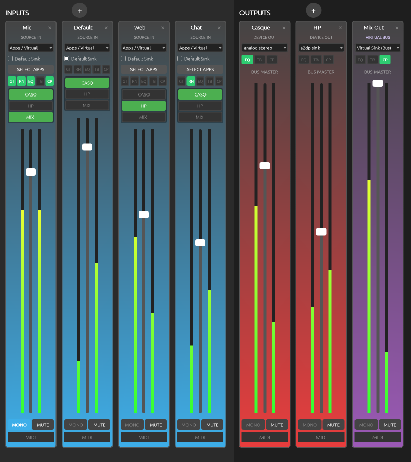

# Portage de l'UI vers Rust / egui — conception

État du portage de l'interface PySide6 vers `egui` 0.37 / `eframe` 0.37, crate
[`rust/crates/holaf-ui`](../rust/crates/holaf-ui).

Les valeurs chiffrées (tailles, couleurs, ordre des rangées, signaux) sont dans
[`docs/ui-inventory.md`](./ui-inventory.md) : ce document-ci décrit
l'**architecture** et le **plan de migration**, pas les constantes.

> **Ce qui existe aujourd'hui** : la fenêtre principale complète (2 sections,
> 7 strips de démonstration, fader + VU animés, boutons FX et routage,
> MONO/MUTE/MIDI), le modèle de thème sérialisable, la résolution pure
> strip → style, un `EngineBridge` à canaux (mock + PipeWire derrière un
> feature), et un rasteriseur logiciel qui produit une capture PNG **sans
> serveur X**.  Ce qui n'existe pas encore : dialogues, menus contextuels,
> MIDI, diagnostic (voir §9).




*Deux captures du **même** code, générées par
`cargo run -p holaf-ui --bin holaf-ui-snapshot -- --width 800 --height 600`
(haute : `--height 900`) — 7 strips, thème `holaf-dark`.  Aucune fenêtre n'a été
ouverte : le rendu passe par le rasteriseur logiciel de `raster.rs` (voir §7).

Elles prouvent les deux règles de dimensionnement (§2bis) : la **largeur est
identique** (800 px, calculée pour 4 entrées + 3 sorties), et seule la **hauteur
change**.  Entre les deux, les rangées fixes d'une strip (nom, caption, combo,
FX, routage, MONO/MUTE, MIDI) sont aux mêmes positions relatives et gardent
exactement la même hauteur ; le **fader** d'entrée passe de 267 px à 567 px
(290 → 590 pour la strip *Default*, qui n'affiche pas `SELECT APPS`) et celui de
sortie de 357 px à 657 px, tandis que MONO/MUTE et MIDI restent collés au bas de
la strip (le fader grandit vers le bas : son haut ne bouge pas).  La strip
elle-même mesure 532 px de haut dans la capture courte et 832 px dans la haute
(fenêtre − 40 px de header − 10 px de marge − 18 px de barre d'état).

---

## 1. Pourquoi Rust pour l'UI

| Problème (PySide6) | Conséquence | Réponse du port |
|---|---|---|
| ~40 couleurs en dur dans des `setStyleSheet` | impossible de thématiser, impossible de tester | modèle de thème **données** + résolution pure (§3) |
| signaux Qt + `QThreadPool` | logique UI/moteur intriquée, tests difficiles | `UiAction` (données) + `EngineBridge` (canaux) (§4) |
| `QWidget` sans capture headless | aucune revue visuelle automatisee en CI | `render()` unique + rasteriseur logiciel (§7) |
| widget Qt = 600 lignes de Python + CSS | duplication Qt/Rust pour la même UI | un seul code de dessin, testable sans GPU |

Le point décisif est le dernier : **une seule fonction de rendu**
(`holaf_ui::render`) sert à la fois la fenêtre eframe, la capture PNG et les
tests.  Il n'y a pas de « mode capture » qui pourrait diverger du mode réel.

---

## 2. Architecture de la crate

```
rust/crates/holaf-ui/
├── Cargo.toml            eframe/egui 0.37 (glow, x11, default_fonts), image 0.25, holaf-core
│                         [[bin]] holaf-ui (eframe) + holaf-ui-snapshot (headless)
├── src/
│   ├── lib.rs            vue d'ensemble + helpers de test (`test_support`)
│   ├── theme/
│   │   ├── mod.rs        HexColor, Fill, ImageSpec/Fit, Theme, ThemeFile, surcharges
│   │   ├── resolve.rs    PUR : descripteur de strip + thème → ResolvedStripStyle
│   │   ├── paint.rs      helpers : dégradé à coins arrondis, mapping d'image (Fit)
│   │   └── images.rs     ImageCache (décodage `image` → TextureHandle, warn-once)
│   ├── widgets/
│   │   ├── fader.rs      fader vertical + VU intégrés (dégradé multi-arrêts)
│   │   └── buttons.rs    FX, routage, MONO/MUTE, MIDI, « + », combo
│   ├── views/
│   │   ├── main_window.rs  2 sections, header, colonnes, barre d'état
│   │   └── strip.rs        une strip (rangées fixes + fader)
│   ├── app.rs            AppState (strips de démo, thème, caches) + UiAction + render()
│   ├── layout.rs         géométrie : largeur Qt verrouillée, strips qui remplissent la hauteur
│   ├── bridge.rs         EngineBridge : thread moteur ↔ UI (mpsc)
│   ├── raster.rs         rasteriseur logiciel (meshes epaint → pixels → PNG)
│   ├── main.rs           binaire eframe
│   └── bin/holaf-ui-snapshot.rs   binaire de capture
└── (tests dans chaque module : 145 tests)
```

### Sens des dépendances

```
views ──► widgets ──► theme/paint ──► theme (données)
  │                                     ▲
  └──────► app (UiAction) ──► bridge ───┘ (theme/resolve est appelé par views)
```

Règles tenues :

* `theme/*` ne connaît **ni** `egui::Context` **ni** le modèle de strips : il
  reçoit des descripteurs (`StripDescriptor`) et rend des styles ;
* `widgets/*` ne mute jamais le modèle : ils rendent un `egui::Response` ;
* `views/*` ne mute jamais le modèle non plus : ils collectent des
  `UiAction` et les rendent à l'appelant ;
* `app.rs` est le seul endroit qui applique une action (`AppState::apply`) ;
* `bridge.rs` est le seul endroit qui parle au moteur.

Cette séparation vient directement des signaux Qt : chaque `Signal` de
`StripWidget` est devenu une **variante de données**, ce qui rend testable ce
que Qt ne permettait pas (un test vérifie que `ToggleFx` sur `out-hp` ne touche
pas `in-mic`, qu'un `DefaultSink` désélectionne les autres strips, qu'un uid
inconnu est ignoré, etc.).

### La crate ne dépend de PipeWire que si on le demande

```toml
[features]
default     = []
engine-pw   = ["dep:holaf-pw"]   # OFF : le squelette compile sans libpipewire
```

`holaf-core` (modèle, tables FX, migrations, `Backend`) est une dépendance dure :
les strips de démonstration sont de **vrais** `holaf_core::model::Strip`, donc
l'UI ne peut pas diverger du modèle du démon.  `holaf-pw` n'est là que pour
`engine-pw`.

---

## 2bis. Dimensionnement de la fenêtre

Décision utilisateur (2026-11-14), implémentée dans `layout.rs` :

1. **Vertical — libre, et les strips remplissent.**  La fenêtre reste
   redimensionnable ; les strips prennent **toute** la hauteur disponible et le
   **fader est le seul élément élastique** (les rangées de boutons gardent leur
   hauteur de thème, voir §« hauteur » ci-dessous).  C'est ce qui remplace
   l'ancien comportement « hauteur naturelle ~394 px, vide en dessous » : la
   fenêtre est une surface de faders, pas une liste de widgets.
2. **Horizontal — verrouillé, calculé.**  La largeur est
   `Σ section_width(count)` (formule Qt exacte, voir
   [`ui-inventory.md`](./ui-inventory.md) §1) et se recalcule toute seule quand
   une strip est ajoutée ou supprimée : `setFixedWidth` côté Qt,
   `ViewportCommand::InnerSize` côté Rust.

### Hauteur : qui prend quoi

| rangée | hauteur | élasticité |
|---|---|---|
| header de section (titre + « + ») | `add_button_size + section_padding` = 40 | fixe |
| strip : nom, caption, combo, FX, `Default Sink`, `SELECT APPS`, plaque de routage / `BUS MASTER` | thème | fixe |
| strip : **fader + VU** | `hauteur_dispo − rangées fixes` | **élastique** (plancher 40 px) |
| strip : MONO/MUTE, MIDI | thème | fixe |
| barre d'état | 18 | fixe (réservée, jamais recouverte) |

`layout::fader_height_for(theme, kind, targets, strip_height)` est la règle
entière en une ligne, et `layout::available_strip_height(theme, hauteur_fenêtre)`
donne la hauteur de strip pour une fenêtre.  Les deux sections reçoivent la
**même** hauteur, donc INPUTS et OUTPUTS restent alignés ; dans une section,
toutes les strips ont la même hauteur.

Sous le plancher (fenêtre plus courte que `layout::minimum_window_height`), le
fader s'arrête à 40 px et les rangées du bas sont **rognées** (`clip_rect` de la
strip) plutôt que dessinées à 2 px.  Ce régime est en principe inatteignable :
`main.rs` envoie `ViewportCommand::MinInnerSize` avec cette hauteur minimale.
Il n'y a **pas** de scroll : Qt en a un (`QScrollArea`), mais un scroll vertical
dans une colonne de faders casse le geste de mixage pour un gain nul (la fenêtre
ne descend pas si bas).

### Comment la largeur est verrouillée (et pourquoi pas `min == max`)

`layout::enforce_window_width(ctx, strips)` est appelé à chaque frame par
`render()` (donc l'app eframe **et** la capture headless passent par le même
code) : il lit `ctx.content_rect().width()`, calcule `required_width_for(strips)`
et n'envoie `ViewportCommand::InnerSize(vec2(requis, hauteur_courante))` **que si
l'écart dépasse 2 px** (`layout::width_correction`, fonction pure).

* `with_min_inner_size == with_max_inner_size` serait une ligne, mais c'est une
  *indication* que le WM applique **après** le drag : la fenêtre s'étire
  visiblement puis revient, et certains WM carrelants l'ignorent.  La commande
  de viewport est déterministe sur tous les backends et se corrige toute seule
  si le WM rate une demande.
* Le seuil de 2 px (arrondi du WM, `pixels_per_point`) est l'anti-boucle : une
  frame où la largeur est déjà bonne **n'émet aucune commande** (testé : deux
  tests headless inspectent `FullOutput.viewport_output[ROOT].commands`).
* La hauteur courante est **conservée** dans la commande : l'axe vertical
  n'appartient qu'à l'utilisateur.

---

## 3. Modèle de thème

### Les fonds de section sont **neutres** ; la couleur vient des strips

C'est la règle de couleur la plus facile à casser en lisant une capture
d'écran, et elle a été cassée une fois : le premier thème `holaf-dark`
peignait les colonnes en bleu/rouge désaturés (`#4a6b80` / `#5a3a44`).  Le code
PySide dit l'inverse — `_create_section("INPUTS", "#2b2b2b", …)` et
`_create_section("OUTPUTS", "#1e1e1e", …)` :

| Élément | Qt (`setStyleSheet`) | thème `holaf-dark` |
|---|---|---|
| fond INPUTS | `#2b2b2b` | `#2b2b2b` |
| fond OUTPUTS | `#1e1e1e` | `#1e1e1e` |
| fond fenêtre | — (les sections couvrent tout) | `#232323` (valeur du thème) |
| strip entrée | `#444444 → #3daee9` | identique |
| strip sortie physique | `#444444 → #e93d3d` | identique |
| strip sortie virtuelle | `#444444 → #9b59b6` | identique |
| strip en learn | `#444444 → #f39c12`, bordure `#f39c12` | identique |
| opacité du corps | 1.0 (opaque) | 1.0 |

Trois conséquences dans le code :

1. `SectionStyles` ne porte **que des gris** ; deux tests le verrouillent —
   `section_backgrounds_are_neutral` (étalement des canaux ≤ 2) et
   `the_two_sections_are_two_grey_levels` (INPUTS plus clair, OUTPUTS plus
   sombre, les deux sombres).
2. le sens du dégradé est `#444` **en haut** → couleur **en bas**
   (`qlineargradient(x1:0, y1:0, x2:0, y2:1, stop:0 #444, stop:1 <accent>)`),
   vérifié par capture de pixels et par un rendu Qt hors écran ; le test
   `strip_bodies_go_from_grey_to_the_kind_accent` l'épingle ;
3. `body_opacity` vaut `1.0` : un strip Qt est **opaque**, la section ne
traverse pas son dégradé.  Mettre 0.82 (la valeur du premier squelette)
délavait les couleurs des strips.

### Hiérarchie

```
ThemeFile                     ← un fichier JSON (~/.config/holaf-mix/theme.json)
├── name, version
├── theme: Theme
│   ├── colors: ThemeColors      (~30 rôles : accent, route_active, mute, texte…)
│   ├── backgrounds              fond de fenêtre, body_opacity, image globale
│   ├── dimensions               strip_width, strip_gap, corner_radius, boutons…
│   ├── typography               tiny/small/body/section_title/heading (+ facteur gras)
│   ├── sections                 { input: SectionStyle, output: SectionStyle }
│   └── strips                   { input/output/bus: StripKindStyle }
└── strips: IndexMap<uid, StripOverride>   surcharges par strip
```

`Fill` est une somme étiquetée (`solid` / `vertical_gradient`), `Fit` décrit le
mapping d'image (`cover`/`contain`/`tile`/`stretch`), `HexColor` est un newtype
`[u8;4]` qui se sérialise en `"#rrggbb"` / `"#rrggbbaa"` et **refuse** une
couleur invalide (une faute de frappe dans un thème doit être signalée, pas
remplacée par du noir).

### Tout est optionnel côté fichier

Chaque struct porte `#[serde(default)]` : un fichier de thème peut ne contenir
que ce qu'il change.

```json
{
  "name": "mon-theme",
  "theme": { "colors": { "accent": "#ff0000" } },
  "strips": {
    "in-mic": { "body": { "type": "solid", "color": "#1b2b1f" }, "opacity_milli": 1000 }
  }
}
```

Les champs inconnus sont ignorés (compatibilité ascendante), une `version`
supérieure à `THEME_FORMAT_VERSION` est **rejetée** (sinon le thème
« marche à moitié »).

### Résolution : `resolve()`

```rust
pub fn resolve(file: &ThemeFile, strip: &StripDescriptor) -> ResolvedStripStyle
```

Fonction **pure** (pas d'I/O, pas d'allocation, pas d'egui), appelée une fois
par strip et par frame :

```
kind      = Input | (Output avec device) | Bus (Output sans device)
body      = (surcharge.body ?? (learning ? style_learn : kind_style).body) × opacité
border    = surcharge.border ?? (learning ? style_learn : kind_style).border
accent    = surcharge.accent ?? colors.accent
opacity   = clamp(surcharge.opacity ?? backgrounds.body_opacity)
image     = surcharge.image ?? kind_style.image
```

`learning` est un drapeau du descripteur (`with_learning(true)`), pas un type de
strip : `set_learning(true)` repeint la frame en orange **quel que soit le type**
et laisse le type intact, exactement comme `_update_base_style`.

Précédence : **surcharge par strip > style par type > défaut intégré**.  Le cas
« bus » est dérivé du modèle (`device_name` absent **ou vide**), exactement
comme `StripWidget._update_base_style` — mais sans if/else dans le code de
dessin.  C'est ce qui permet de tester « une sortie sans device est violette »
sans ouvrir de fenêtre.

---

## 4. Threading : `EngineBridge`

```
thread UI (egui, 60 fps)                    thread moteur
──────────────────────────                  ─────────────
AppState::apply(UiAction)
   ├─ mute le modèle localement
   ├─ EngineCommand ──────mpsc──────────►   recv()
   └─ empile l'action (config/undo)                │
                                                   ├─ Backend::set_volume / set_mute / …
                                                   │  (ou mock en mémoire)
AppState::poll_engine()   ◄────mpsc───── EngineEvent::{Ready, Applied, Levels, Error}
   └─ statut + niveaux VU
```

Points de conception :

1. **Aucun blocage.** `send` est non bloquant ; un moteur mort devient
   `BridgeError::Disconnected` dans la barre d'état, jamais un gel.
2. **Le backend appartient au thread moteur.** Avec `engine-pw`,
   `PipeWireBackend::connect()` est appelé **dans** le thread (le mainloop
   pipewire doit vivre là où il est itéré) — la closure
   `EngineBridge::spawn_with` reçoit la commande *et* le `HashMap` de niveaux.
3. **Un seul canal de commandes** (pas de pool de threads) : `PipeWireBackend`
   est déjà un handle `Send` qui marshale vers son worker.
4. **Changements structurels = snapshot.** Ajouter/supprimer/renommer une strip
   reconstruit le plan de graphe : on envoie la **liste complète**
   (`SyncSnapshot(Vec<Strip>)`), pas une commande ponctuelle.
5. **Métrage.** `Backend::meter_sources()` ne fait que *nommer* les sources à
   capter (spec §6) : le bridge mock fabrique des niveaux déterministes pour la
   démo, la capture et les tests ; la capture réelle des `<node>.monitor` reste
   le travail d'intégration moteur (voir §9).

Le mock (`EngineBridge::spawn_mock`) n'a **aucune dépendance temporelle** : il
applique la commande et renvoie `Applied` + `Levels`, ce qui rend les tests
déterministes ; l'UI anime ses VU par une fonction du temps (`AppState::animate`)
quand aucun bridge n'est branché.

---

## 5. Une seule fonction de rendu

```rust
pub fn render(state: &mut AppState, ui: &mut egui::Ui)
```

Trois appelants, un seul chemin de code :

| appelant | contexte | ce qu'il prouve |
|---|---|---|
| `src/main.rs` (`eframe::App::ui`) | fenêtre réelle, GPU | l'app |
| `src/bin/holaf-ui-snapshot.rs` | `Context::run_ui` + raster logiciel | la capture PNG |
| tests (`views::strip::strip_paints_headless_in_every_state`) | `Context` sans renderer | pas de panique de layout |

`eframe` 0.37 ne fournit plus `App::update` mais `App::ui(&mut Ui, &mut Frame)`
— vérifié dans la doc de la crate, la coquille `main.rs` ne fait que déléguer.

---

## 6. Modèle d'interaction (le remplacement des signaux)

`UiAction` couvre exactement les signaux de `strip_widget.py` (table complète
dans `docs/ui-inventory.md` §7).  Deux conséquences pratiques :

* un changement de modèle est **une valeur**, donc testable :

  ```rust
  state.apply(UiAction::ToggleFx { uid: "out-hp".into(),
                                   effect: EffectKey::Tube, active: true });
  assert!(hp.effects[&EffectKey::Tube].active);
  assert!(!mic.effects[&EffectKey::Tube].active);
  ```

* `apply` est aussi le point d'où partent la commande moteur, l'écriture de
  config (à venir) et le log — un seul endroit à instrumenter.

Les actions purement UI (ouvrir un dialogue, armer un learn MIDI) ne produisent
**aucune** commande moteur : c'est explicite dans `engine_command()`.

---

## 7. Capture sans serveur X

Ce conteneur n'a ni X11, ni Wayland, ni Xvfb : `eframe` ne peut pas ouvrir de
fenêtre, donc la capture d'écran d'eframe est hors d'atteinte.  La chaîne
retenue :

```
Context::run_ui(RawInput{screen_rect, time, native_pixels_per_point = scale})
        │  (le MÊME render() que l'app)
        ▼
Context::tessellate(shapes, ppp)         → Vec<ClippedPrimitive> (meshes epaint)
        ▼
raster::render(framebuffer)               → triangles en CPU, blending prémultiplié
        ▼   (clip rects respectés, atlas de police échantillonné en bilinéaire)
Framebuffer::downsample(scale)            → anti-aliasing par sur-échantillonnage
        ▼
PNG (crate `image`)
```

Détails qui comptent :

* le rasteriseur reproduit les **mêmes maths que le shader epaint** : couleurs
  prémultipliées en sRGB, multiplication par le texel en gamma, blending
  `dst = src + dst·(1−a)` ;
* l'atlas de police est récupéré **après** la passe (`ctx.fonts(|f| f.image())`),
  sinon les glyphes utilisés n'y sont pas encore ;
* le sur-échantillonnage (`--scale 2`) compense l'absence de *feathering* sur
  les meshes construits à la main (le tessellateur ne feather que ses propres
  formes) ;
* `FullOutput.textures_delta` **panique** au drop s'il reste des deltas : ils
  sont systématiquement vidés (`clear()`).

```bash
cd rust
cargo run -p holaf-ui --bin holaf-ui-snapshot -- --out /tmp/holaf-ui.png
cargo run -p holaf-ui --bin holaf-ui-snapshot -- --scale 3 --time 2.0
cargo run -p holaf-ui --bin holaf-ui-snapshot -- --theme /tmp/mon-theme.json
```

Pièges vérifiés sur egui 0.37 (ils coûtent une heure chacun) :

| piège | symptôme | correctif |
|---|---|---|
| `ui.max_rect()` | vaut la zone *disponible* (5000 × 5000), pas la fenêtre | `ui.ctx().content_rect()` |
| `ctx.set_pixels_per_point()` | écrase le `screen_rect` demandé (zoom factor × ratio) | `RawInput.viewports[ROOT].native_pixels_per_point` |
| `Ui::id()` / `Id::new()` | dépréciés en 0.37 | `Ui::scope_id()`, `Id::unique()`, `IdSalt` |
| `egui::Rounding` | n'existe plus | `CornerRadius` (u8) |

---

## 8. Stratégie de migration : `HOLAF_UI=rust|python`

Le daemon `holafd` et son client Python sont déjà en place ; l'UI Rust vient
**après**, et doit pouvoir être essayée sans renoncer à l'UI Qt.

### 8.1 Le commutateur

`main.py` reste le point d'entrée unique :

```python
choice = os.environ.get("HOLAF_UI", "python").strip().lower()   # défaut : python
if choice == "rust":
    from src.backend import rust_ui_launcher           # à écrire (voir 8.3)
    if not rust_ui_launcher.launch():                  # binaire absent / écran absent
        logger.warning("HOLAF_UI=rust indisponible — repli sur l'UI Python")
        choice = "python"
```

Règles, calquées sur celles déjà en place pour le moteur
(`HOLAF_USE_PYTHON=1`, daemon Rust par défaut) :

1. **défaut = python** tant que la parité n'est pas atteinte (aucune surprise
   pour les utilisateurs) ;
2. **repli automatique** : binaire manquant, pas de `DISPLAY`/`WAYLAND_DISPLAY`,
   version de thème non supportée ⇒ UI Qt, avec une ligne de log ;
3. **jamais deux UI en même temps** : le verrou d'instance unique existant
   (`QLocalServer`/fichier pid) doit être partagé, sinon deux fenêtres pilotent
   le même démon ;
4. **config.json reste la source de vérité** : l'UI Rust lit/écrit le même
   fichier via `holaf_core::config` + `migration::strip_from_dict` (elle ne
   réimplémente pas la migration).

### 8.2 Ce que l'UI Rust ne refait pas

| Domaine | Reste où c'est | Pourquoi |
|---|---|---|
| Graphe PipeWire, FX, routage | `holafd` (déjà Rust) | l'UI ne parle jamais à PipeWire directement |
| Métrage | capture Python/`holaf-pw` selon le jalon | `meter_sources()` ne nomme que les sources |
| MIDI | Python (`midi_engine`) | pas de crate MIDI dans les dépendances actuelles |
| Diagnostic | Python (`src/diagnostics/`) | collecte pure, déjà testée |
| Packaging | PyInstaller existant | l'UI Rust sera un binaire séparé embarqué dans le bundle |

### 8.3 Plan par étapes

| Étape | Livrable | Critère de sortie |
|---|---|---|
| **0 (fait)** | squelette compilable : thème + résolution + widgets + vue principale + capture PNG + tests | `cargo test -p holaf-ui` vert, capture produite |
| **1** | parité de **lecture** : charger `config.json`, afficher les vraies strips/devices (via `Backend::device_list`) | la capture de l'UI Rust et une capture Qt de la même config se superposent |
| **2** | parité d'**écriture** : `holaf-ui` branché sur `holafd` (feature `engine-pw` ou socket IPC), VU réels | volume/MUTE/MONO/FX/routage agissent sur le graphe ; tests live |
| **3** | dialogues : renommer, sélection d'apps, paramètres FX, menu contextuel applicatif | aucune fonction Qt perdue (checklist de `ui-inventory.md` §9) |
| **4** | MIDI (learn + retour) et persistance de géométrie | un contrôleur pilote le fader |
| **5** | bascule du défaut à `HOLAF_UI=rust`, `HOLAF_UI=python` en échappatoire | une release complète sans régression signalée |

Chaque étape ajoute des tests **sans** toucher aux 177 tests Python ni aux 203
tests Rust existants (`cargo test --workspace`, `python -m unittest discover -s
tests` restent la référence).

---

## 9. Écarts connus (état actuel)

| Manque | Effet visible | Étape |
|---|---|---|
| moteur réel non branché par défaut | VU animés par une fonction du temps | 2 |
| liste de devices absente | le combo affiche le device courant mais n'ouvre rien | 1 |
| dialogues (rename OK, apps/FX non) | clic sans effet (statut) | 3 |
| menus contextuels | absents | 3 |
| MIDI | bouton présent, learn non câblé au moteur | 4 |
| police « gras » simulée | deux tracés décalés au lieu d'une vraie graisse | 3 |
| boutons FX à 16 px sur les entrées | Qt les fixe à 22 (118 px de boutons dans 90 px : les derniers sont rognés) — le port les rétrécit pour tous les voir | assumé |

Ces écarts sont **choisis et documentés** : aucun n'est un oubli silencieux.

---

## 10. Vérification

```bash
cd rust
cargo build -p holaf-ui                    # 0 warning
cargo test  -p holaf-ui                    # 145 tests
cargo test  --workspace                    # 349 tests (dont les 203 existants)
cargo build -p holaf-ui --features engine-pw   # le chemin PipeWire compile aussi
cargo run   -p holaf-ui --bin holaf-ui-snapshot -- --out /tmp/holaf-ui.png
```

Les captures de référence sont versionnées ici :
[`docs/ui-rust-snapshot.png`](./ui-rust-snapshot.png) (600 px de haut) et
[`docs/ui-rust-snapshot-tall.png`](./ui-rust-snapshot-tall.png) (900 px de haut).

---

## 11. Raccourcis

* Inventaire chiffré : [`docs/ui-inventory.md`](./ui-inventory.md)
* Spec de la réécriture Rust : [`docs/rust-rewrite-spec.md`](./rust-rewrite-spec.md)
* État des jalons moteur : [`docs/rust-rewrite-status.md`](./rust-rewrite-status.md)
* Guide du workspace Rust : [`rust/README.md`](../rust/README.md)
