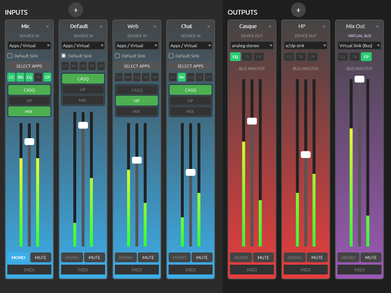

# Portage de l'UI vers Rust / egui — conception

État du portage de l'interface PySide6 vers `egui` 0.37 / `eframe` 0.37, crate
[`rust/crates/holaf-ui`](../rust/crates/holaf-ui).

Les valeurs chiffrées (tailles, couleurs, ordre des rangées, signaux) sont dans
[`docs/ui-inventory.md`](./ui-inventory.md) : ce document-ci décrit
l'**architecture** et le **plan de migration**, pas les constantes.

> **Ce qui existe aujourd'hui** : l'UI **fonctionnelle** — elle charge le vrai
> `config.json` (migrations et clés inconnues préservées), pilote le graphe
> PipeWire par `holaf-pw` (`apply_snapshot`, volume, MUTE/MONO, FX et leurs
> paramètres, routage, device, default sink, ajout/suppression/renommage),
> affiche des **VU réels** (capture `pw-cat` → RMS × 5 → `Arc<[AtomicU32]>`,
> enveloppe de décroissance), persiste chaque modification (écriture atomique
> débouncée) et affiche un **bandeau** quand le démon manque (mode déconnecté).
> Dialogues présents : paramètres FX, ajout de strip, confirmation de
> suppression, choix de device, **sélection d'applications**, **diagnostic** et
> **choix du contrôleur MIDI**
> (`--dialog` du binaire de capture), menus contextuels fenêtre / strip / FX,
> always-on-top, MIDI (contrôleur, learn, LED, reconnexion).  L'**icône de tray**
> est **activée par défaut au build** (feature `tray` — backend **`ksni`**, un
> D-Bus StatusNotifierItem, donc plus de GTK3/libappindicator ;
> `HOLAF_NO_TRAY=1` pour l'enlever) — voir §10quater.




*Trois captures du **même** code, générées par
`cargo run -p holaf-ui --bin holaf-ui-snapshot -- --config ../config.json
--height 600` (haute : `--height 900`) — les **7 strips du vrai `config.json`**
(4 entrées, 3 sorties, volumes/faders et MUTE tels que l'utilisateur les a
laissés), thème `holaf-dark`, VU de démonstration déterministes.  Aucune fenêtre
n'a été ouverte : le rendu passe par le rasteriseur logiciel de `raster.rs`
(voir §7).

Elles prouvent les deux règles de dimensionnement (§2bis) : la **largeur est
identique** (800 px, calculée pour 4 entrées + 3 sorties), et seule la **hauteur
change**.  Entre les deux, les rangées fixes d'une strip (nom, caption, combo,
FX, routage, MONO/MUTE, MIDI) sont aux mêmes positions relatives et gardent
exactement la même hauteur ; le **fader** d'entrée passe de 267 px à 567 px
(290 → 590 pour la strip *Default*, qui n'affiche pas `SELECT APPS`) et celui de
sortie de 357 px à 657 px, tandis que MONO/MUTE et MIDI restent collés au bas de
la strip (le fader grandit vers le bas : son haut ne bouge pas).  La strip
elle-même mesure 532 px de haut dans la capture courte et 832 px dans la haute
(fenêtre − 40 px de header − 10 px de marge − 18 px de barre d'état).

---

## 1. Pourquoi Rust pour l'UI

| Problème (PySide6) | Conséquence | Réponse du port |
|---|---|---|
| ~40 couleurs en dur dans des `setStyleSheet` | impossible de thématiser, impossible de tester | modèle de thème **données** + résolution pure (§3) |
| signaux Qt + `QThreadPool` | logique UI/moteur intriquée, tests difficiles | `UiAction` (données) + `EngineBridge` (canaux) (§4) |
| `QWidget` sans capture headless | aucune revue visuelle automatisee en CI | `render()` unique + rasteriseur logiciel (§7) |
| widget Qt = 600 lignes de Python + CSS | duplication Qt/Rust pour la même UI | un seul code de dessin, testable sans GPU |

Le point décisif est le dernier : **une seule fonction de rendu**
(`holaf_ui::render`) sert à la fois la fenêtre eframe, la capture PNG et les
tests.  Il n'y a pas de « mode capture » qui pourrait diverger du mode réel.

---

## 2. Architecture de la crate

```
rust/crates/holaf-ui/
├── Cargo.toml            eframe/egui 0.37 (glow, **wayland**, default_fonts ;
│                         `x11` = feature opt-in), image 0.25, holaf-core
│                         [[bin]] holaf-ui (eframe) + holaf-ui-snapshot (headless)
├── src/
│   ├── lib.rs            vue d'ensemble + helpers de test (`test_support`)
│   ├── theme/
│   │   ├── mod.rs        HexColor, Fill, ImageSpec/Fit, Theme, ThemeFile, surcharges
│   │   ├── resolve.rs    PUR : descripteur de strip + thème → ResolvedStripStyle
│   │   ├── paint.rs      helpers : dégradé à coins arrondis, mapping d'image (Fit)
│   │   └── images.rs     ImageCache (décodage `image` → TextureHandle, warn-once)
│   ├── widgets/
│   │   ├── fader.rs      fader vertical + VU intégrés (dégradé multi-arrêts)
│   │   └── buttons.rs    FX, routage, MONO/MUTE, MIDI, « + », combo
│   ├── views/
│   │   ├── main_window.rs  2 sections, header, colonnes, barre d'état
│   │   └── strip.rs        une strip (rangées fixes + fader)
│   ├── app.rs            AppState (strips, thème, engine, config) + UiAction + render()
│   ├── layout.rs         géométrie : largeur Qt verrouillée, strips qui remplissent la hauteur
│   ├── bridge.rs         EngineBridge : thread moteur ↔ UI (mpsc) + EngineCommand/Event
│   ├── config.rs         config.json : lecture + migrations, écriture atomique débouncée,
│   │                     préservation des clés inconnues, géométrie de fenêtre
│   ├── meters.rs         RMS/peak, enveloppe de décroissance, MeterBoard (Arc<[AtomicU32]>)
│   ├── capture.rs        captures `pw-cat` (une par source) → MeterBoard   [engine-pw]
│   ├── coalesce.rs       throttle 25 Hz du fader
│   ├── dialogs.rs        paramètres FX, ajout, confirmation, device, apps, diagnostic
│   ├── devices.rs        identité d'un device : match description/structure, (Not Found)
│   ├── apps.rs           app_list/app_move, dialogue SELECT APPS, enforcement 5 s
│   ├── menus.rs          menus contextuels (fenêtre/strip/FX) + « Open project page »
│   ├── diagnostics.rs    rapport depuis status() + constats automatiques + texte
│   ├── midi.rs           mapping CC/note → action, learn, feedback LED, port/reconnexion
│   ├── tray.rs           politique du tray + always-on-top + icône générée   [tray]
│   ├── fx_ui.rs          plages/ordre des ports de contrôle (table Qt)
│   ├── engine_json.rs    parsing `meter_sources` / `device_list` / `app_list`
│   ├── raster.rs         rasteriseur logiciel (meshes epaint → pixels → PNG)
│   ├── main.rs           binaire eframe (+ `--config`, `--midi`, `--midi-list`, `MidiDevice`)
│   └── bin/holaf-ui-snapshot.rs   capture (+ `--dialog`, `--dialog-tab`)
├── tests/engine_live.rs  harnais live (graphe réel, gaté sur le démon headless)
├── examples/config_probe.rs  ce que l'UI lit/écrit vraiment dans un config.json
└── (tests dans chaque module : 286 tests, 489 dans le workspace)
```

### Sens des dépendances

```
views ──► widgets ──► theme/paint ──► theme (données)
  │                                     ▲
  └──────► app (UiAction) ──► bridge ───┘ (theme/resolve est appelé par views)
```

Règles tenues :

* `theme/*` ne connaît **ni** `egui::Context` **ni** le modèle de strips : il
  reçoit des descripteurs (`StripDescriptor`) et rend des styles ;
* `widgets/*` ne mute jamais le modèle : ils rendent un `egui::Response` ;
* `views/*` ne mute jamais le modèle non plus : ils collectent des
  `UiAction` et les rendent à l'appelant ;
* `app.rs` est le seul endroit qui applique une action (`AppState::apply`) ;
* `bridge.rs` est le seul endroit qui parle au moteur.

Cette séparation vient directement des signaux Qt : chaque `Signal` de
`StripWidget` est devenu une **variante de données**, ce qui rend testable ce
que Qt ne permettait pas (un test vérifie que `ToggleFx` sur `out-hp` ne touche
pas `in-mic`, qu'un `DefaultSink` désélectionne les autres strips, qu'un uid
inconnu est ignoré, etc.).

### La crate ne dépend de PipeWire que si on le demande

```toml
[features]
default     = ["engine-pw"]      # l'UI est un mixer : le moteur réel par défaut
engine-pw   = ["dep:holaf-pw"]
```

`--no-default-features` compile **sans** `holaf-pw` (donc sans libpipewire) : la
capture PNG, les tests et un poste sans démon s'en servent, le mock est alors le
seul moteur.

`holaf-core` (modèle, tables FX, migrations, `Backend`) est une dépendance dure :
les strips de démonstration sont de **vrais** `holaf_core::model::Strip`, donc
l'UI ne peut pas diverger du modèle du démon.

---

## 2bis. Dimensionnement de la fenêtre

Décision utilisateur (2026-11-14), implémentée dans `layout.rs` :

1. **Vertical — libre, et les strips remplissent.**  La fenêtre reste
   redimensionnable ; les strips prennent **toute** la hauteur disponible et le
   **fader est le seul élément élastique** (les rangées de boutons gardent leur
   hauteur de thème, voir §« hauteur » ci-dessous).  C'est ce qui remplace
   l'ancien comportement « hauteur naturelle ~394 px, vide en dessous » : la
   fenêtre est une surface de faders, pas une liste de widgets.
2. **Horizontal — verrouillé, calculé.**  La largeur est
   `Σ section_width(count)` (formule Qt exacte, voir
   [`ui-inventory.md`](./ui-inventory.md) §1) et se recalcule toute seule quand
   une strip est ajoutée ou supprimée : `setFixedWidth` côté Qt,
   `ViewportCommand::InnerSize` côté Rust.

### Hauteur : qui prend quoi

| rangée | hauteur | élasticité |
|---|---|---|
| header de section (titre + « + ») | `add_button_size + section_padding` = 40 | fixe |
| strip : nom, caption, combo, FX, `Default Sink`, `SELECT APPS`, plaque de routage / `BUS MASTER` | thème | fixe |
| strip : **fader + VU** | `hauteur_dispo − rangées fixes` | **élastique** (plancher 40 px) |
| strip : MONO/MUTE, MIDI | thème | fixe |
| barre d'état | 18 | fixe (réservée, jamais recouverte) |

`layout::fader_height_for(theme, kind, targets, strip_height)` est la règle
entière en une ligne, et `layout::available_strip_height(theme, hauteur_fenêtre)`
donne la hauteur de strip pour une fenêtre.  Les deux sections reçoivent la
**même** hauteur, donc INPUTS et OUTPUTS restent alignés ; dans une section,
toutes les strips ont la même hauteur.

Sous le plancher (fenêtre plus courte que `layout::minimum_window_height`), le
fader s'arrête à 40 px et les rangées du bas sont **rognées** (`clip_rect` de la
strip) plutôt que dessinées à 2 px.  Ce régime est en principe inatteignable :
`main.rs` envoie `ViewportCommand::MinInnerSize` avec cette hauteur minimale.
Il n'y a **pas** de scroll : Qt en a un (`QScrollArea`), mais un scroll vertical
dans une colonne de faders casse le geste de mixage pour un gain nul (la fenêtre
ne descend pas si bas).

### Comment la largeur est verrouillée (et pourquoi pas `min == max`)

`layout::enforce_window_width(ctx, strips)` est appelé à chaque frame par
`render()` (donc l'app eframe **et** la capture headless passent par le même
code) : il lit `ctx.content_rect().width()`, calcule `required_width_for(strips)`
et n'envoie `ViewportCommand::InnerSize(vec2(requis, hauteur_courante))` **que si
l'écart dépasse 2 px** (`layout::width_correction`, fonction pure).

* `with_min_inner_size == with_max_inner_size` serait une ligne, mais c'est une
  *indication* que le WM applique **après** le drag : la fenêtre s'étire
  visiblement puis revient, et certains WM carrelants l'ignorent.  La commande
  de viewport est déterministe sur tous les backends et se corrige toute seule
  si le WM rate une demande.
* Le seuil de 2 px (arrondi du WM, `pixels_per_point`) est l'anti-boucle : une
  frame où la largeur est déjà bonne **n'émet aucune commande** (testé : deux
  tests headless inspectent `FullOutput.viewport_output[ROOT].commands`).
* La hauteur courante est **conservée** dans la commande : l'axe vertical
  n'appartient qu'à l'utilisateur.

---

## 3. Modèle de thème

### Les fonds de section sont **neutres** ; la couleur vient des strips

C'est la règle de couleur la plus facile à casser en lisant une capture
d'écran, et elle a été cassée une fois : le premier thème `holaf-dark`
peignait les colonnes en bleu/rouge désaturés (`#4a6b80` / `#5a3a44`).  Le code
PySide dit l'inverse — `_create_section("INPUTS", "#2b2b2b", …)` et
`_create_section("OUTPUTS", "#1e1e1e", …)` :

| Élément | Qt (`setStyleSheet`) | thème `holaf-dark` |
|---|---|---|
| fond INPUTS | `#2b2b2b` | `#2b2b2b` |
| fond OUTPUTS | `#1e1e1e` | `#1e1e1e` |
| fond fenêtre | — (les sections couvrent tout) | `#232323` (valeur du thème) |
| strip entrée | `#444444 → #3daee9` | identique |
| strip sortie physique | `#444444 → #e93d3d` | identique |
| strip sortie virtuelle | `#444444 → #9b59b6` | identique |
| strip en learn | `#444444 → #f39c12`, bordure `#f39c12` | identique |
| opacité du corps | 1.0 (opaque) | 1.0 |

Trois conséquences dans le code :

1. `SectionStyles` ne porte **que des gris** ; deux tests le verrouillent —
   `section_backgrounds_are_neutral` (étalement des canaux ≤ 2) et
   `the_two_sections_are_two_grey_levels` (INPUTS plus clair, OUTPUTS plus
   sombre, les deux sombres).
2. le sens du dégradé est `#444` **en haut** → couleur **en bas**
   (`qlineargradient(x1:0, y1:0, x2:0, y2:1, stop:0 #444, stop:1 <accent>)`),
   vérifié par capture de pixels et par un rendu Qt hors écran ; le test
   `strip_bodies_go_from_grey_to_the_kind_accent` l'épingle ;
3. `body_opacity` vaut `1.0` : un strip Qt est **opaque**, la section ne
traverse pas son dégradé.  Mettre 0.82 (la valeur du premier squelette)
délavait les couleurs des strips.

### Hiérarchie

```
ThemeFile                     ← un fichier JSON (~/.config/holaf-mix/theme.json)
├── name, version
├── theme: Theme
│   ├── colors: ThemeColors      (~30 rôles : accent, route_active, mute, texte…)
│   ├── backgrounds              fond de fenêtre, body_opacity, image globale
│   ├── dimensions               strip_width, strip_gap, corner_radius, boutons…
│   ├── typography               tiny/small/body/section_title/heading (+ facteur gras)
│   ├── sections                 { input: SectionStyle, output: SectionStyle }
│   └── strips                   { input/output/bus: StripKindStyle }
└── strips: IndexMap<uid, StripOverride>   surcharges par strip
```

`Fill` est une somme étiquetée (`solid` / `vertical_gradient`), `Fit` décrit le
mapping d'image (`cover`/`contain`/`tile`/`stretch`), `HexColor` est un newtype
`[u8;4]` qui se sérialise en `"#rrggbb"` / `"#rrggbbaa"` et **refuse** une
couleur invalide (une faute de frappe dans un thème doit être signalée, pas
remplacée par du noir).

### Tout est optionnel côté fichier

Chaque struct porte `#[serde(default)]` : un fichier de thème peut ne contenir
que ce qu'il change.

```json
{
  "name": "mon-theme",
  "theme": { "colors": { "accent": "#ff0000" } },
  "strips": {
    "in-mic": { "body": { "type": "solid", "color": "#1b2b1f" }, "opacity_milli": 1000 }
  }
}
```

Les champs inconnus sont ignorés (compatibilité ascendante), une `version`
supérieure à `THEME_FORMAT_VERSION` est **rejetée** (sinon le thème
« marche à moitié »).

### Résolution : `resolve()`

```rust
pub fn resolve(file: &ThemeFile, strip: &StripDescriptor) -> ResolvedStripStyle
```

Fonction **pure** (pas d'I/O, pas d'allocation, pas d'egui), appelée une fois
par strip et par frame :

```
kind      = Input | (Output avec device) | Bus (Output sans device)
body      = (surcharge.body ?? (learning ? style_learn : kind_style).body) × opacité
border    = surcharge.border ?? (learning ? style_learn : kind_style).border
accent    = surcharge.accent ?? colors.accent
opacity   = clamp(surcharge.opacity ?? backgrounds.body_opacity)
image     = surcharge.image ?? kind_style.image
```

`learning` est un drapeau du descripteur (`with_learning(true)`), pas un type de
strip : `set_learning(true)` repeint la frame en orange **quel que soit le type**
et laisse le type intact, exactement comme `_update_base_style`.

Précédence : **surcharge par strip > style par type > défaut intégré**.  Le cas
« bus » est dérivé du modèle (`device_name` absent **ou vide**), exactement
comme `StripWidget._update_base_style` — mais sans if/else dans le code de
dessin.  C'est ce qui permet de tester « une sortie sans device est violette »
sans ouvrir de fenêtre.

---

## 4. Threading : `EngineBridge`

```
thread UI (egui, 60 fps)                    thread moteur
──────────────────────────                  ─────────────
AppState::apply(UiAction)
   ├─ mute le modèle localement
   ├─ EngineCommand ──────mpsc──────────►   recv()
   └─ empile l'action (config/undo)                │
                                                   ├─ Backend::set_volume / set_mute / …
                                                   │  (ou mock en mémoire)
AppState::poll_engine()   ◄────mpsc───── EngineEvent::{Ready, Applied, Failed, Levels, Devices, Error}
   │  statut + rollback des commandes refusées
   └── MeterBoard::read(uid)  ◄──────────  Arc<[AtomicU32]> (f32 bits, 25 Hz)
```

Points de conception :

1. **Aucun blocage.** `send` est non bloquant ; un moteur mort devient
   `BridgeError::Disconnected` (puis le bandeau « mode déconnecté »), jamais un
   gel.
2. **Le backend appartient au thread moteur.** Avec `engine-pw`,
   `PipeWireBackend::connect()` est appelé **dans** le thread (le mainloop
   pipewire doit vivre là où il est itéré) — la closure
   `EngineBridge::spawn_with` reçoit la commande *et* le `HashMap` de niveaux.
3. **Un seul canal de commandes** (pas de pool de threads) : `PipeWireBackend`
   est déjà un handle `Send` qui marshale vers son worker.
4. **Changements structurels = snapshot.** Ajouter/supprimer/renommer une strip —
   et **changer de device** (debounce 200 ms, comme
   `_schedule_engine_restart`) — reconstruit le plan de graphe : on envoie la
   **liste complète** (`SyncSnapshot(Vec<Strip>)`), pas une commande ponctuelle.
   Renommer suffit à renommer le bus côté démon (`Holaf_Bus_<label>`).
5. **Métrage réel, hors du démon** (spec §6). `Backend::meter_sources()` ne fait
   que *nommer* les sources ; le thread moteur ouvre une capture `pw-cat
   --record --target <source>.monitor --format f32 -` par source
   ([`capture`](../rust/crates/holaf-ui/src/capture.rs)), calcule RMS et peak par
   bloc de 10 ms ([`meters`](../rust/crates/holaf-ui/src/meters.rs)) et publie le
   **niveau dBFS** (`−60 dBFS → 0`, `+6 dBFS → 1`, voir §10sexies.2) dans un
   `Arc<[AtomicU32]>`.  Un bloc **impossible** (pic > +40 dBFS : flux relu avec
   le mauvais format d'échantillon) est rejeté — barre noire + une ligne de
   journal — au lieu d'être collé à 1.0.  L'UI
   lit ces atomes à 25 Hz et applique `level = max(new, prev·0.85)` (par 40 ms,
   indépendant du framerate) pour que les barres redescendent.
6. **UI optimiste avec rollback.** Chaque changement réversible est enregistré
   (`Undo`) avant d'être envoyé ; une commande refusée revient comme
   `EngineEvent::Failed { command, reason }`, l'UI **rétablit** la valeur
   précédente du modèle et l'affiche dans la barre d'état.

Le mock (`EngineBridge::spawn_mock`) n'a **aucune dépendance temporelle** : il
applique la commande et renvoie `Applied` + `Levels`, ce qui rend les tests
déterministes ; il n'a **pas** de `MeterBoard` (testé), donc les niveaux passent
par les événements.  L'UI anime ses VU par une fonction du temps
(`AppState::animate`) quand aucun bridge n'est branché (capture PNG, tests).

### 4bis. Mode déconnecté

`PipeWireBackend::connect()` peut échouer (pas de démon, pas de permission, pas
de `libpipewire`).  Le thread moteur **reste vivant** et répond
`Failed(command, reason)` à chaque ordre : l'UI affiche un bandeau rouge
(`views::main_window::ENGINE_BANNER_HEIGHT`, testé au pixel près), garde toutes
ses commandes de modèle (faders, dialogues, config) et **journalise/ignore** les
actions audio.  Aucun panic, aucun gel : c'est un état de première classe.

### 4ter. Persistance

`AppState::from_config(path)` charge le `config.json` réel via
[`config::UiConfig`](../rust/crates/holaf-ui/src/config.rs) — `load_config` +
`migration::strip_from_dict` (les mêmes migrations que le démon) — plus la
géométrie (`window.height`) et le thème (`theme`, un nom ou un chemin).

Chaque action persistante programme une écriture **atomique débouncée** (400 ms,
une écriture par geste).  L'écriture part du **document chargé** et ne patche que
les clés modélisées, strip par strip (appariées par `uid`) : `mode`,
`assigned_apps`, `midi_volume`/`midi_mute`/`midi_mono`, `window_geometry` (le blob
Qt) et toute clé inconnue **survivent** — les perdre au premier mouvement de
fader serait une perte de données, pas une simplification.  Un config absent
laisse l'UI démarrer vide (largeur minimale 160+160) avec un avertissement
visible ; un config corrompu est signalé et **jamais réécrit**.

Quatre règles de préservation, chacune avec son test :

| clé | règle |
|---|---|
| `effects` | patché **clé par clé** depuis le bloc chargé : un effet que le modèle ne connaît pas (`reverb`, `limiter`, …) garde sa place et ses valeurs ; les cinq connus sont fusionnés dedans |
| `mode` | gardé du fichier tant que `device_name` n'a pas changé dans l'UI (`physical` + `device_name: null` reste `physical`) ; re-dérivé seulement sur un vrai changement de device |
| `uid` absent | réparé **avant** le mapping des extras (`in-legacy-N`, dédoublonné) : un strip sans `uid` garde son `mode`, ses `assigned_apps` et ses `midi_*` |
| `window.width` | réécrit seulement s'il existait déjà ; jamais **ajouté** à un fichier qui n'en a pas |

### 4quater. Géométrie : ce que l'UI s'autorise à réécrire

Seule la **hauteur** est persistée (`window.height`), et seulement après un
geste de redimensionnement :

* la hauteur chargée du fichier est la valeur à défendre ; la taille que le WM
  (ou `MinInnerSize`) impose au lancement n'est **pas** une décision de
  l'utilisateur, donc elle n'est jamais écrite — un simple lancement ne touche
  pas `config.json` ;
* la comparaison est *observé vs observé* (jamais observé vs persisté) : une
  taille de démarrage constante, quelle qu'elle soit, ne programme aucune
  écriture ;
* les premières frames (`app::RESIZE_ARM_FRAMES`) sont ignorées, le temps que la
  fenêtre se stabilise, et un écart < 2 px (`app::RESIZE_JITTER`) est du bruit.

La largeur, elle, est **verrouillée** sur `Σ section_width` : ce n'est pas un
choix de l'utilisateur, elle n'est donc écrite que si le fichier la portait déjà.
Le blob Qt `window_geometry` est conservé octet pour octet, et `window_state`
(état Qt hérité, `h` = hauteur du **cadre**) reste une clé opaque : `h` ne sert de
repli que si aucune hauteur n'est disponible, `window.height` primant toujours
(les deux ne mesurent pas la même chose).

---

## 5. Une seule fonction de rendu

```rust
pub fn render(state: &mut AppState, ui: &mut egui::Ui)
```

Trois appelants, un seul chemin de code :

| appelant | contexte | ce qu'il prouve |
|---|---|---|
| `src/main.rs` (`eframe::App::ui`) | fenêtre réelle, GPU | l'app |
| `src/bin/holaf-ui-snapshot.rs` | `Context::run_ui` + raster logiciel | la capture PNG |
| tests (`views::strip::strip_paints_headless_in_every_state`) | `Context` sans renderer | pas de panique de layout |

`eframe` 0.37 ne fournit plus `App::update` mais `App::ui(&mut Ui, &mut Frame)`
— vérifié dans la doc de la crate, la coquille `main.rs` ne fait que déléguer.

---

## 6. Modèle d'interaction (le remplacement des signaux)

`UiAction` couvre exactement les signaux de `strip_widget.py` (table complète
dans `docs/ui-inventory.md` §7).  Deux conséquences pratiques :

* un changement de modèle est **une valeur**, donc testable :

  ```rust
  state.apply(UiAction::ToggleFx { uid: "out-hp".into(),
                                   effect: EffectKey::Tube, active: true });
  assert!(hp.effects[&EffectKey::Tube].active);
  assert!(!mic.effects[&EffectKey::Tube].active);
  ```

* `apply` est aussi le point d'où partent les commandes moteur
  (`engine_commands(&action, &strips)`), l'écriture de config débouncée et le
  log — un seul endroit à instrumenter.

Les actions purement UI (ouvrir un dialogue, armer un learn MIDI, demander une
confirmation) ne produisent **aucune** commande moteur : c'est explicite dans
`engine_commands()`.

### Trois règles que Qt appliquait implicitement

| règle | Qt | Rust |
|---|---|---|
| le fader ne spamme pas le moteur | `QTimer` 50 ms (`_check_and_send_volume`, « 20 Hz limit ») | `coalesce::Throttled<f32>`, 40 ms (25 Hz), dernière valeur gagnante — testé sans dormir |
| un changement de device = **un** redémarrage | `_schedule_engine_restart` + `DEBOUNCE_ENGINE_RESTART_MS = 200` | `SaveDebounce` 200 ms → **un** `SyncSnapshot` pour toute la rafale |
| une modification = une écriture | `save_config` à chaque signal | `SaveDebounce` 400 ms + `save_config_atomic`, une écriture par geste |

Les dialogues vivent dans [`dialogs`](../rust/crates/holaf-ui/src/dialogs.rs) :
paramètres FX (sliders par port, plages `fx_ui::range_for_param`, ordre
`fx_ui::sorted_param_keys`, ports `=` masqués), ajout de strip (nom + type),
confirmation de suppression (`QMessageBox` « default No »), choix de device
(`device_list` filtré par `media_class`, plus « Virtual Bus »).  Le renommage
garde son dialogue dans `app.rs`.

Une commande refusée revient en `EngineEvent::Failed` : `AppState::rollback`
rétablit la valeur précédente (volume, mute, mono, FX, paramètres, routes,
default sink, device) et l'annonce dans la barre d'état.

---

## 7. Capture sans serveur X

Ce conteneur n'a ni X11, ni Wayland, ni Xvfb : `eframe` ne peut pas ouvrir de
fenêtre, donc la capture d'écran d'eframe est hors d'atteinte.  La chaîne
retenue :

```
Context::run_ui(RawInput{screen_rect, time, native_pixels_per_point = scale})
        │  (le MÊME render() que l'app)
        ▼
Context::tessellate(shapes, ppp)         → Vec<ClippedPrimitive> (meshes epaint)
        ▼
raster::render(framebuffer)               → triangles en CPU, blending prémultiplié
        ▼   (clip rects respectés, atlas de police échantillonné en bilinéaire)
Framebuffer::downsample(scale)            → anti-aliasing par sur-échantillonnage
        ▼
PNG (crate `image`)
```

Détails qui comptent :

* le rasteriseur reproduit les **mêmes maths que le shader epaint** : couleurs
  prémultipliées en sRGB, multiplication par le texel en gamma, blending
  `dst = src + dst·(1−a)` ;
* l'atlas de police est récupéré **après** la passe (`ctx.fonts(|f| f.image())`),
  sinon les glyphes utilisés n'y sont pas encore ;
* le sur-échantillonnage (`--scale 2`) compense l'absence de *feathering* sur
  les meshes construits à la main (le tessellateur ne feather que ses propres
  formes) ;
* `FullOutput.textures_delta` **panique** au drop s'il reste des deltas : ils
  sont systématiquement vidés (`clear()`).

```bash
cd rust
cargo run -p holaf-ui --bin holaf-ui-snapshot -- --out /tmp/holaf-ui.png
cargo run -p holaf-ui --bin holaf-ui-snapshot -- --scale 3 --time 2.0
cargo run -p holaf-ui --bin holaf-ui-snapshot -- --theme /tmp/mon-theme.json
cargo run -p holaf-ui --bin holaf-ui-snapshot -- --config ../config.json
```

`--config` rend les strips **réelles** de ce fichier ; la capture est en lecture
seule (le store de config est détaché, aucune écriture débouncée ne peut toucher
le fichier rendu).

Pièges vérifiés sur egui 0.37 (ils coûtent une heure chacun) :

| piège | symptôme | correctif |
|---|---|---|
| `ui.max_rect()` | vaut la zone *disponible* (5000 × 5000), pas la fenêtre | `ui.ctx().content_rect()` |
| `ctx.set_pixels_per_point()` | écrase le `screen_rect` demandé (zoom factor × ratio) | `RawInput.viewports[ROOT].native_pixels_per_point` |
| `Ui::id()` / `Id::new()` | dépréciés en 0.37 | `Ui::scope_id()`, `Id::unique()`, `IdSalt` |
| `egui::Rounding` | n'existe plus | `CornerRadius` (u8) |

---

## 8. Stratégie de migration : `HOLAF_UI=rust|python`

> **Étape 5 FAITE (bascule B1).**  `HOLAF_UI` vaut `rust` par défaut :
> `main.py` est devenu un **lanceur** (`src/launcher.py`) qui exécute le binaire
> `holaf-ui`, et l'UI Qt n'est plus qu'une échappatoire (`HOLAF_UI=python` ou
> `HOLAF_USE_PYTHON=1`).  Le plan de suppression du Python est dans
> [`migration-to-pure-rust.md`](migration-to-pure-rust.md).

Le daemon `holafd` et son client Python sont déjà en place ; l'UI Rust vient
**après**, et doit pouvoir être essayée sans renoncer à l'UI Qt.

### 8.1 Le commutateur (implémenté)

`main.py` reste le point d'entrée unique :

```python
# src/launcher.py — la règle réelle, défaut : rust
if launcher.python_ui_forced():        # HOLAF_UI=python / HOLAF_USE_PYTHON=1
    run_python_ui()
else:
    result = launcher.launch(sys.argv[1:])   # résout holaf-ui et l'exécute
    if result.launched:
        sys.exit(result.exit_code)           # code de sortie propagé
    logger.warning("Rust UI unavailable (%s) — starting the classic Python UI", result.reason)
    run_python_ui(result.reason)
```

Ordre de résolution de `holaf-ui` (calqué sur celui de `holafd`) :
`$HOLAF_UI_BIN` → bundle PyInstaller (à côté de l'exécutable, puis
`sys._MEIPASS`, puis `_internal/`, avec restauration du bit exécutable) →
`rust/target/{release,debug}` → `$PATH`.

Règles, calquées sur celles déjà en place pour le moteur
(`HOLAF_USE_PYTHON=1`, daemon Rust par défaut) :

1. ~~défaut = python~~ → **défaut = rust** depuis B1 (l'échappatoire reste) ;
2. **repli automatique** : binaire `holaf-ui` manquant ou non exécutable ⇒ UI
   Qt, avec un WARNING qui porte la raison *et* un message dans la barre de
   statut (un bundle packagé n'a pas de stderr).  Un binaire qui **démarre**
   n'est jamais doublé : son code de sortie est propagé, donc « pas d'écran »
   affiche le message d'eframe au lieu d'ouvrir Qt ;
3. **jamais deux UI en même temps** : l'UI Rust pilote PipeWire **dans son
   processus** (pas de démon, pas de socket) ; l'UI Qt est le seul cas où
   `holafd` est lancé, et elle ne tourne que si `holaf-ui` n'a pas démarré ;
4. **config.json reste la source de vérité** : l'UI Rust lit/écrit le même
   fichier via `holaf_core::config` + `migration::strip_from_dict`.  Comme
   `default_config_path()` côté Rust part du **répertoire courant** (alors que
   l'UI Qt part de son propre chemin), le lanceur épingle `--config` sur le
   fichier de l'UI Qt : c'est ce qui rend la bascule réversible.

### 8.2 Ce que l'UI Rust ne refait pas

| Domaine | Reste où c'est | Pourquoi |
|---|---|---|
| Graphe PipeWire, FX, routage | `holafd` (déjà Rust) | l'UI ne parle jamais à PipeWire directement |
| Métrage | capture Python/`holaf-pw` selon le jalon | `meter_sources()` ne nomme que les sources |
| Diagnostic | Python (`src/diagnostics/`) | collecte pure, déjà testée |
| Packaging | PyInstaller existant | l'UI Rust sera un binaire séparé embarqué dans le bundle |

Le MIDI n'est plus dans cette liste : le port est fait (§10ter), et l'**icône de
tray** l'est aussi (§10quater) — **activée par défaut au build**, backend `ksni` sans GTK (elle ajoute
GTK3 + libappindicator, que le script de build sait contourner en réessayant
sans la feature).

### 8.3 Plan par étapes

| Étape | Livrable | Critère de sortie |
|---|---|---|
| **0 (fait)** | squelette compilable : thème + résolution + widgets + vue principale + capture PNG + tests | `cargo test -p holaf-ui` vert, capture produite |
| **1 (fait)** | parité de **lecture** : `AppState::from_config` charge `config.json` (migrations, clés inconnues), la géométrie et le thème ; `Backend::device_list` alimente le choix de device | `holaf-ui-snapshot --config ../config.json` rend les 7 vraies strips |
| **2 (fait)** | parité d'**écriture** : `holaf-ui` pilote `PipeWireBackend` en direct (`default = ["engine-pw"]`), VU réels par capture `pw-cat`, rollback sur refus, mode déconnecté | volume/MUTE/MONO/FX/routage/device agissent sur le graphe ; `tests/engine_live.rs` vert |
| **3 (fait)** | dialogues : renommer, ajout/suppression, paramètres FX, choix de device, **sélection d'applications**, **diagnostic** ; menus contextuels fenêtre/strip/FX ; always-on-top | aucune fonction Qt perdue (checklist de `ui-inventory.md` §9) |
| **4 (fait)** | MIDI complet : mapping CC/note, **learn par propriété** (menu du bouton MIDI), feedback LED, **choix du port** + reconnexion automatique, `midi` dans les features par défaut | un AKAI MIDI Mix pilote le mixeur sans re-apprentissage (§10ter) |
| **5 (fait, B1)** | bascule du défaut à `HOLAF_UI=rust`, `HOLAF_UI=python` en échappatoire ; `holaf-ui` packagé (spec, tarball, PKGBUILD, `.desktop`, CI) | aucune régression signalée sur l'artefact CI (le tarball `holaf-mix-<version>-<arch>.tar.gz`) ; le paquet Arch (PKGBUILD) reste une option de distribution, non exercée par la CI |
| **6 (fait, B2)** | **icône de tray** (feature `tray`, **activée par défaut au build** depuis le 2026-11-14 ; backend **`ksni`**/D-Bus depuis le 2026-11-15, donc **sans GTK**) : menu Qt, « fermer = cacher » seulement si un tray existe **et** qu'un hôte StatusNotifier est présent, icône **générée** en RGBA (aucune dépendance fichier), repli sans display testé, pile GTK3/GLib **retirée du bundle PyInstaller** (le système fournit celle du fallback Qt) | `cargo test -p holaf-ui --features tray` vert (dont `tray_live` : enregistrement D-Bus + menu publié) + `cargo build --features tray` en CI (§10quater) |

Chaque étape ajoute des tests **sans** toucher aux 207 tests Python
(`python -m unittest discover -s tests` reste la référence) ; le workspace Rust
est passé de 349 à **569** tests, dont **342** pour `holaf-ui` (322 unitaires +
19 d'intégration — `midi_config` pour la compatibilité `config.json`, `midi_live`
pour le port, `engine_live` pour le moteur — + 1 doctest), et **343** avec
`--features tray` (le test de repli sans display ne se compile que là).

---

## 9. Écarts connus (état actuel)

| Manque | Effet visible | Étape |
|---|---|---|
| **tray icon** | **fait** (2026-11-14, backend **ksni**/D-Bus depuis le 2026-11-15 — plus de GTK), **activé par défaut au build** (`scripts/build_rust.sh`, donc PKGBUILD/tarball/CI ; `HOLAF_NO_TRAY=1` pour l'enlever) : sans hôte StatusNotifier, ou sans display, il n'y a pas d'icône et fermer la fenêtre **quitte** — choix sûr, cacher rendrait l'app inatteignable. Depuis le 2026-11-15 il porte **tout** le menu applicatif (l'ancien menu clic droit de la fenêtre n'existe plus) : `Show/Hide`, `MIDI port...`, `Restart audio engine`, `Debug window`, `Open project page`, `Quit`. La croix **cache dans le tray** par défaut (`ui_rust.tray_hide_on_close`, défaut `true` comme Qt) — la demande de l'utilisateur ; sans tray réel (aucun hôte StatusNotifier) elle **quitte**. Le no-op Wayland de `Visible(false)` est neutralisé par la paire `Visible` + `Minimized`. Voir §10quater | fait |
| `pw-dump` dans le diagnostic | le port Rust ne lit pas `pw-dump` : le **démon** publie déjà son propre graphe (`status().holaf_nodes`, `strips[].node_name`, `pending`), ce qui couvre les constats utiles. En revanche le **quantum** est publié (`status.timing`, depuis `pw-metadata -n settings` : `rate`, `quantum`, `force-quantum`, min/max) et `small_quantum` (< 256) est actif ; les compteurs **ERR** ne sont disponibles que si `pw-top -b` existe (PipeWire ≥ 0.3.66) — en 0.3.65 le binaire n'a pas de mode batch, donc `pwt_errors` reste muet et `pw_top_unavailable` (info) affiche la raison exacte. Rien n'est inventé | assumé |
| routage applicatif côté démon | **fait** : `Backend::app_list` liste les flux de sortie audio (`pactl -f json list sink-inputs` + `list sinks` pour résoudre le `node.name` du bus) en excluant les flux du démon (son pid, ses enfants — les `pw-cat` de métrage —, ses nœuds `Holaf_*` et l'app Qt), et `app_move` déplace le flux via le gestionnaire de session (`pactl move-sink-input`) **puis relit** la liste pour vérifier que le flux est bien sur le bus ; `stub: true` n'est plus renvoyé | fait |
| apprentissage MIDI par propriété | **fait** : le bouton MIDI d'un strip ouvre le menu Qt (`Learn Volume` / `Learn Mute` / `Learn Mono`, `Clear Mappings`, plus `Cancel learn` quand un learn est armé) ; voir §10ter | fait |
| police « gras » simulée | deux tracés décalés au lieu d'une vraie graisse | 3 |
| boutons FX à 16 px sur les entrées | Qt les fixe à 22 (118 px de boutons dans 90 px : les derniers sont rognés) — le port les rétrécit pour tous les voir | assumé |
| plage `HF key filter` élargie à 24 kHz | Qt clampe à 20 kHz, ce qui réécrivait le défaut du plugin (23520 Hz) à l'ouverture du dialogue | assumé |
| géométrie de fenêtre | seule la **hauteur** est relue/écrite (`window.height`), et seulement après un resize réel ; le blob Qt `window_geometry` et l'état Qt `window_state` sont préservés tels quels ; `window.width` n'est jamais ajouté | assumé |

Ces écarts sont **choisis et documentés** : aucun n'est un oubli silencieux.

---

## 10. Vérification

```bash
cd rust
cargo build -p holaf-ui                          # défaut : moteur PipeWire + MIDI
cargo build -p holaf-ui --no-default-features    # UI seule (ni libpipewire ni libasound)
cargo build -p holaf-ui --features midi --no-default-features   # MIDI sans moteur
cargo build -p holaf-ui --features tray          # l'icône de tray (ce que le script de build ajoute)
cargo test  -p holaf-ui                          # 342 (322 unitaires + 19 d'intégration + 1 doctest)
cargo test  -p holaf-ui --features tray          # idem + le repli sans display
cargo test  --workspace                          # 569 tests
cargo clippy -p holaf-ui --all-targets           # 0 warning (idem toutes les combinaisons)
cargo run   -p holaf-ui -- --midi-list           # les noms de ports que --midi accepte
cargo run   -p holaf-ui --bin holaf-ui-snapshot -- --out /tmp/holaf-ui.png
cargo run   -p holaf-ui --bin holaf-ui-snapshot -- --config ../config.json --height 900
```

### Captures de dialogues

Le même binaire sait ouvrir un dialogue avant de rendre, avec un **moteur mock**
déterministe (`status`, `device_list`, `app_list` canned) : le rendu ne dépend
donc pas d'un démon.

```bash
cargo run -p holaf-ui --bin holaf-ui-snapshot -- \
    --config ../config.json --dialog diagnostics --dialog-tab engine \
    --out ../docs/ui-rust-dialog.png --height 700
# --dialog : diagnostics | apps | fx | device | add | delete | menu
#            midi-port | midi-port-none | midi-learn | midi-menu
# --dialog-tab : summary | engine | graph | system | journal
# --captures : dead | misread | live   (section CAPTURES de l'onglet Graph ;
#              le moteur mock ne lance aucun pw-cat, donc sans ce drapeau la
#              section ne peut montrer que « no capture is running »)
```

Un dialogue est une `egui::Area` : il flotte **au-dessus** de la fenêtre et ne
l'élargit jamais. La capture verrouille donc la zone de la fenêtre à
`layout::required_width` (794 px pour les sept strips) même quand la toile est
plus large — sans ce verrou, rendre la mise en page calculée pour 794 px dans
une toile de 900 px étirait les deux colonnes de `900/794` et laissait ~72 px de
fond à droite du dernier strip (au lieu des 12 px de la formule Qt : 10 px de
marge + 2 px de jeu). `--width 900` agrandit désormais la **toile** seulement :
la fenêtre garde sa largeur verrouillée et les colonnes en trop sont peintes en
`#141414` (« hors fenêtre »), avec une note sur la sortie d'erreur.

### Test live (harnais `tests/engine_live.rs`)

Le seul test qui prouve que le câblage est réel ; il est **sauté** sans démon
headless (même garde que `holaf-pw/tests/backend_live.rs`) :

```bash
eval "$(./scripts/start-pipewire-headless.sh --export)"
cd rust && cargo test -p holaf-ui --test engine_live -- --nocapture
```

Il charge un config à 2 strips, attache le vrai `EngineBridge`, puis vérifie :
le bus `Holaf_Bus_UI_Out` existe ; un drag de fader simulé laisse
`channelVolumes = 0.44³` (courbe PulseAudio, pas 0.44 brut) côté démon ; un
toggle FX charge `Holaf_FX_out-bus` ; un sinus 1 kHz joué dans le bus fait monter
le VU puis l'enveloppe le ramène à zéro ; `shutdown()` ne laisse **aucun** nœud
`Holaf_*` ni enfant `pw-cat`.

Il couvre aussi les deux fonctions « quotidiennes » : `app_list`/`app_move`
contre le démon réel (l'answer doit être **capable** — `stub: false`,
`source: pactl` — même quand rien ne joue dans le bac à sable) et la fenêtre de
diagnostic, dont le rapport doit décrire le **vrai** graphe (`Holaf_Bus_UI_In`),
sans constat `daemon_unreachable`.

Le déplacement d'un flux est prouvé séparément, en live, par
`holaf-pw/tests/app_routing_live.rs` : un `pw-cat --playback` détaché est listé,
déplacé sur le bus d'un strip (`app_move`), puis **relu** sur ce bus ; trois flux
au profil « à nous » (notre pid, un pid enfant, un `node.name` `Holaf_*`) sont
exclus avec leur raison. Sur PipeWire 0.3.65 `pw-top` n'a pas de mode batch, donc
les compteurs ERR restent indisponibles — le rapport l'affiche comme tel
(`pw_top_unavailable`), il n'invente pas de zéro.

Les captures de référence sont versionnées ici :
[`docs/ui-rust-snapshot.png`](./ui-rust-snapshot.png) (600 px de haut),
[`docs/ui-rust-snapshot-tall.png`](./ui-rust-snapshot-tall.png) (900 px de haut)
et [`docs/ui-rust-dialog.png`](./ui-rust-dialog.png) (fenêtre de diagnostic,
onglet *Engine*).

---

## 10bis. Lot « usage quotidien » (implémenté après le squelette)

Sept briques, chacune avec sa politique **pure** (donc testée sans démon, sans
fenêtre et sans matériel) et son câblage dans `AppState` :

| module | rôle | politique testable |
|---|---|---|
| `devices.rs` | identité d'un device : le `node.name` meurt au reboot/re-plug, la **description** et la structure du nom survivent | `resolve()` (nom exact → casse → description → score vendor/profil/identité, refus si deux candidats), `reconcile()` (réparation + liste des manquants), `presence()` (marqueur `!` dans la combo **seulement** si l'engine a répondu ; la combo n'affiche que le segment de profil, le `node.name` complet est dans l'infobulle). **Seul un match qui garde le segment d'instance (`is_confident`, score ≥ 5) réécrit et sauvegarde `device_name`** ; un match vendor+profil (score 4) est *proposé* dans la barre d'état, jamais appliqué ni persisté |
| `config.rs` | la hauteur de fenêtre vit dans `window.height` (clé partagée avec Qt) ; `ui_rust.always_on_top` est la seule clé propre au port Rust ; `assigned_apps` et `midi_*` restent des clés UI-only préservées | round-trip + « le blob `window_geometry` de Qt est intact » |
| `menus.rs` | menus contextuels fenêtre / strip / bouton FX, mêmes entrées et même ordre que `build_app_context_menu`, + « Open project page » (`xdg-open` → `gio open` → `sensible-browser`, sans dépendance) | `entries(kind)` / `labels(kind)` / `action_for()` |
| `diagnostics.rs` | rapport structuré depuis `status()` + constats automatiques (`daemon_unreachable`, `engine_not_running`, `graph_degraded`, `graph_pending`, `fx_host_down`, `fx_host_respawns`, `fx_host_inprocess`, `mainloop_pumps_stalled/zero/external`, `legacy_bus_names`, `strip_bus_unnamed`, `strip_bus_missing`, `device_missing`, `device_not_listed`, `metering_no_source`, `multiple_daemons`) | `Report::collect(&Inputs)` + `detect()` ; texte copiable, constats en tête. `strip_bus_missing` ne juge que les strips **virtuels** et `mainloop_pumps_*` que le mode FX **inprocess** (cf. `src/diagnostics/collector.py`, mêmes règles) |
| `apps.rs` | « SELECT APPS » + enforcement : `running ∪ assigned`, `enforces()` (entrée virtuelle non-default), `plan()` (idempotent, une app assignée deux fois n'est déplacée qu'une fois), bus = `status.strips[].node_name` sinon `Holaf_Bus_<Label>` | `AppList::parse`, `plan()`, `AppSelection` |
| `midi.rs` | CC → volume (`value/127`), note → bascule mute/mono sur **press** seulement, learn par propriété, feedback LED, choix/reconnexion du port (`midir`, feature `midi` **par défaut**) — voir §10ter | `MidiMessage::parse`, `decode()`, `feedback()`, `MidiMap`, `choose_port()`, `MidiRuntime` |
| `tray.rs` | politique du tray (entrées, « fermer = cacher seulement si un tray existe »), always-on-top, **icône générée en RGBA** — feature `tray` **activée par défaut au build** (`HOLAF_NO_TRAY=1` pour l'enlever) — voir §10quater | `close_action()`, `menu_action()`, `icon_rgba(size)` (pixels déterministes, testés sans GTK) |

Côté `AppState` : `SelectAppsDone` (persiste `assigned_apps` puis déplace),
`tick_app_enforcement()` (une question `app_list` toutes les 5 s, seulement si un
strip prend des apps), `RestartEngine` (anti-réentrance, `Connecting` →
`Restarted`), `OpenDiagnostics`/`refresh_diagnostics()`, `handle_midi_message()`,
`SetAlwaysOnTop` (un `ViewportCommand::WindowLevel` par changement).

---

## 10ter. MIDI : le AKAI MIDI Mix comme contrôleur principal

Le MIDI n'est pas un extra : c'est **la** façon de mixer de l'utilisateur (huit
faders + vingt-quatre boutons). Trois conséquences pour l'implémentation : le port
doit être là **par défaut**, les mappings déjà écrits par l'UI Python doivent être
**repris tels quels**, et l'assignation d'un contrôle doit se faire **en le
jouant** (aucun CC codé en dur — le MIDI Mix n'est qu'une convention).

### 10ter.1 Où vit quoi

| Couche | Rôle | Testé sans matériel |
|---|---|---|
| `midi.rs` (toujours compilé) | `MidiMessage::parse` (note_on/off, CC ; clock/sysex ignorés), `Binding` ↔ JSON, `MidiMap` (clé `type × canal × id`), `decode()` (CC → `value/127`, note → bascule sur **press**, throttle 10 ms/strip), `feedback()` / `button_feedback()` (LED), `choose_port()`, `MidiRuntime` (machine à états de connexion) | oui — 15 tests unitaires (`cargo test -p holaf-ui --lib midi::tests`) |
| `midi.rs` (feature `midi`) | `MidiPort` (midir : un port in, un port out, un thread), `Ports::ports()` (in + out), `MidiVirtualSource` | `tests/midi_live.rs` (auto-sauté sans séquenceur ALSA) |
| `AppState` | `handle_midi_message()` → `UiAction` (donc persisté/rollback/engine comme un clic), `midi_learn()`, `clear_midi_bindings()`, `midi_summary()` | oui — via `handle_midi_message` directement, sans port |
| `main.rs` (`MidiDevice`) | ouverture, sondage du port toutes les 2 s, reconnexion, LEDs | non (I/O) |

La règle de découpage est celle du reste de la crate : la **politique** est pure et
testée partout, l'**I/O** est dans le binaire.

### 10ter.2 Format de persistance (compatible Python, vérifié)

`config.json` porte trois clés par strip, écrites par `Strip.to_dict` et relues
par `Strip.from_dict` (`src/models/strip_model.py`) :

```json
"midi_volume": {"channel": 0, "control": 61, "type": "control_change"},
"midi_mute":   {"channel": 0, "note": 24,    "type": "note_on"},
"midi_mono":   {"channel": 0, "note": 22,    "type": "note_on"},
"midi_volume": null                                    // non mappé
```

Canal et identifiants sont **0-based** (l'UI affiche `ch.1` pour le canal 0).
`midi_engine.py` (`send_feedback`) écrit des `note_on` 127/0 pour une LED de
bouton, ou un CC 127/0 pour un contrôleur qui pilote ses LEDs en CC.

Côté Rust, `Binding::to_json`/`from_json` produisent exactement ces objets, et
`UiConfig` les traite comme des clés UI-only (elles sont **recopiées** au save,
jamais reconstruites depuis `Strip`). Preuve par test
(`tests/midi_config.rs`) :

* `the_python_config_is_loaded_with_its_mappings` — le **vrai** `config.json` du
dépôt, chargé par `AppState::from_config` : les 18 mappings des 6 strips mappés,
les `null` du bus virtuel, et la résolution `CC 19 → Mic`, `CC 23 → Default`, …
* `a_save_keeps_the_python_shape` — un save réécrit les trois clés de **chaque**
  strip à l'identique (objet par objet, `null` compris) ; le blob Qt et `mode`
  sont intacts ;
* `the_mappings_survive_a_volume_change` — le save routinier (déplacement de
  fader) ne les perd pas ;
* `a_bare_number_mapping_is_understood_and_repaired` — la seule autre forme
  imaginable (`"midi_volume": 61`, sur quoi l'UI **Python plante** :
  `TypeError: 'int' object is not subscriptable` dans `_rebuild_midi_lookup`) est
  lue (canal 0 + forme naturelle de la cible) et **réparée** au premier save en
  objet.

Le **port** n'a pas de clé côté Python : `MainWindow._init_midi` reprenait à
chaque démarrage le premier port dont le nom contient `mix`, sinon le premier
tout court. Le port Rust ajoute donc sa propre préférence —
`ui_rust.midi_port` — que Python recopie sans le lire (`load_config`/
`save_config` ne réécrivent que `strips[]` et `window_geometry`).

### 10ter.3 Sélection du port, démarrage, reconnexion

1. **Démarrage** : `ui_rust.midi_port` présent et dans la liste → ouvert. Absent
   (**jamais choisi**) → `choose_port()` reconnaît le MIDI Mix (`midi mix` puis
   `mix`), sinon l'unique port s'il n'y en a qu'un, sinon rien ; le choix est
   **mémorisé** (premier démarrage « plug and play »). Absent de la liste →
   avertissement + liste des ports dans le log, et le nom reste attendu.
   `null` (choix explicite « No controller ») n'est **jamais** écrasé.
2. **Log de démarrage** : chaque port in/out est listé avec son nom exact
   (`midi:   in  MIDI Mix:MIDI Mix MIDI 1 24:0`), ce qui est précisément ce que
   `--midi PORT` et le sélecteur attendent.
3. **Menu fenêtre → `MIDI port...`** : la liste des entrées + « No controller » ;
   la sélection est écrite dans `ui_rust.midi_port` et appliquée à la frame
   suivante (aucun redémarrage).
4. **Reconnexion** : `MidiRuntime` (pur) impose un essai immédiat puis **toutes
   les 2 s** (`RETRY_INTERVAL`) tant que le port est absent ou a disparu. La
   présence est vérifiée en re-listant les ports (midir ne signale pas un
   débranchement) ; un échec de *listage* (pas de séquenceur ALSA du tout) est une
   condition statique : backoff à 10 s pour ne pas inonder la console. L'état
   courant est dans la barre d'état (`MIDI: <port> unavailable (...) - retrying
   every 2 s`).
5. **`--midi PORT`** force un port pour la session (non persisté) ;
   **`--midi-list`** imprime les entrées et les sorties (LED) avec leur nom exact
   et échoue proprement s'il n'y a pas de séquenceur.

### 10ter.4 Learn : le parcours, identique à Qt

| Étape | Qt (`strip_widget._show_midi_menu` + `midi_engine`) | Rust |
|---|---|---|
| Ouvrir le menu | clic sur le bouton `MIDI` | clic (ou clic droit) sur le même bouton → même menu |
| Entrées | `Learn Volume`, `Learn Mute`, `Learn Mono`, — , `Clear Mappings` | identiques, **+ `Cancel learn`** en tête quand un learn est armé (Qt n'avait aucun retour en arrière) |
| Armer | `start_learning(uid, prop)` + bouton orange `LEARNING...` | `MidiLearnTarget` → `midi_learning = Some((uid, target))`, même bouton orange (le **cadre du strip** passe en orange aussi, comme `set_learning`) |
| Capturer | premier `control_change` ou `note_on/off` → `learning_mode = False` | `decode()` renvoie `Learned` ; **le learn s'arrête** (un geste = une propriété) |
| Stocker | `strip.midi_volume|mute|mono = mapping` + `_save_state()` | `set_midi_binding` + `request_save` (même forme JSON) |
| Feedback | LED du bouton synchronisée | idem, **+ le bouton affiche `CC 19` / `N 24` pendant 1,5 s** (vert) — Qt revenait à `MIDI` sans confirmation |
| Voir les mappings | rien (il fallait lire `config.json`) | **survol du bouton** : `CC 19 ch.1 -> volume`, `N 24 ch.1 -> mute`, … + le contrôleur connecté |
| Effacer | `Clear Mappings` (les trois) | identique (`null` dans le fichier, comme Python) |

Différences **assumées** : `Cancel learn`, le flash du CC, l'infobulle et la
mémorisation du port. Aucune ne change le fichier ni le comportement observable
côté contrôleur.

### 10ter.5 Retour LED

Oui, le Python le fait (`MidiEngine.send_feedback`, appelé par
`_sync_initial_midi_leds`, `on_midi_message_received` et les toggles souris) :

* un mapping `note_on` s'allume en `note_on` vélocité **127**, s'éteint à **0** ;
  un mapping CC en `control_change` valeur 127/0 — c'est la forme du binding,
  donc la LED suit son propre bouton ;
* les boutons `mute`/`mono` de tous les strips sont resynchronisés à l'ouverture
  du port, puis **une fois par seconde** (un MUTE cliqué à la souris, un strip
  ajouté, un undo : la lampe doit suivre le mixeur, pas le dernier événement
  MIDI) ;
* un mapping `volume` n'a pas de LED (un fader n'en a pas).

Les octets partent par un **thread d'écriture** dédié : un contrôleur qui cesse
de drainer ne bloque jamais l'UI.

### 10ter.6 Ce qui est testé, et ce qui ne peut pas l'être ici

Tests **sans matériel** (tout le reste) : parsing, mapping, learn par propriété,
persistance JSON, throttle, LED, choix de port, machine de reconnexion (temps
injecté), résumé d'infobulle, `config.json` réel chargé et réécrit à l'identique.

Non testable dans ce conteneur : **l'I/O MIDI réelle**. `/dev/snd/seq` est absent
et il n'y a ni `modprobe` ni `CAP_SYS_MODULE` ; donc ni `snd-virmidi`, ni
`snd-aloop`, ni `midir::create_virtual` (qui exige le séquenceur ALSA) : aucun port
virtuel n'est créable. `tests/midi_live.rs` contient les trois tests qui
l'exerceraient (listage exact des noms, erreur propre sur un port absent, un
contrôleur virtuel → `CC 19 / 100` reçu par `MidiPort`) ; sans séquenceur ils
**sautent** en imprimant la raison, et ils tournent réellement sur un poste :

```bash
cd rust && cargo test -p holaf-ui --test midi_live -- --nocapture
```

### 10ter.7 Brancher un AKAI MIDI Mix (chez l'utilisateur)

```bash
# 1. les noms de ports vus par ALSA ("MIDI Mix:MIDI Mix MIDI 1 24:0")
cargo run -p holaf-ui -- --midi-list
#    (équivalent système : aconnect -l  /  aseqdump -l)

# 2. lancer l'UI : le MIDI Mix est reconnu et mémorisé au premier démarrage
cargo run -p holaf-ui -- --config ../config.json
#    log attendu : "midi: selected \"MIDI Mix:...\" automatically"
#                   "midi: listening on \"MIDI Mix:...\""

# 3. forcer un port pour une session (sans le mémoriser)
cargo run -p holaf-ui -- --midi "MIDI Mix:MIDI Mix MIDI 1 24:0"

# 4. vérifier le learn : clic sur le bouton MIDI d'un strip (ou clic droit)
#    → "Learn Volume" → bouger le fader voulu → le bouton affiche "CC 19"
#    → le fader du mixeur suit ; survoler le bouton liste les mappings

# 5. changer de contrôleur : menu du tray (icône) → "MIDI port..."

# 6. débrancher/rebrancher : reconnexion automatique en 2 s, état dans la barre
#    (`MIDI: <port> unavailable (...) - retrying every 2 s`)
```

Les mappings déjà présents dans `config.json` sont utilisés **sans
re-apprentissage** : c'est ce que verrouille `tests/midi_config.rs`.

---

## 10quater. Tray : icône de zone de notification (feature `tray`)

Le tray est la dernière brique Qt portée.  Il vit dans `src/tray.rs` et se
découpe en deux : une **politique** toujours compilée (pure, testée en toutes
configurations) et une **I/O** derrière la feature `tray`.

> **MISE À JOUR 2026-11-15 — le backend est `ksni`, plus GTK.**
> `tray-icon` est passé de 0.19 + `libappindicator`/`gtk 0.18` à **0.26 +
> feature `ksni`** : un `org.kde.StatusNotifierItem` en **D-Bus pur**.  Ce qui
> change pour le lecteur des sections ci-dessous, qui décrivent l'état du
> 2026-11-14 :
>
> * **plus de `gtk::init()` ni de `gtk::main()`** — ksni a son propre worker
>   D-Bus ; le thread `holaf-tray` ne fait plus que garder le `TrayIcon` vivant
>   (il `park`), et la feature n'ajoute **aucune** bibliothèque système ;
> * **plus de paquets `gtk3` / `libayatana-appindicator`** dans le PKGBUILD, la
>   CI, `build.sh` ou `BUILD.md` ; `ldd holaf-ui | grep -i gtk` est **vide**, et
>   `gtk 0.18` (ligne fermée) sort du graphe de dépendances, ce qui élimine
>   aussi RUSTSEC-2024-0370 (`proc-macro-error`, tiré par `gtk3-macros`) ;
> * l'hôte appindicator devient un **hôte StatusNotifier** (mêmes bureaux :
>   KDE/Plasma, waybar, `swaybar`, `gnome-shell-extension-appindicator`) ;
> * **nouveauté** : l'app interroge D-Bus (`org.kde.StatusNotifierWatcher`) au
>   démarrage — l'équivalent de `isSystemTrayAvailable()` — parce que le backend
>   ksni, lui, se déclare disponible même sans hôte ; sans hôte, `available()`
>   reste `false` et fermer **quitte** ;
> * la pile GTK3/GLib reste retirée du bundle PyInstaller, mais désormais
>   **uniquement pour le fallback Qt** (`libqgtk3.so` de PySide6) ;
> * `--features tray-gtk` conserve l'ancien backend libappindicator comme filet
>   de sécurité (jamais activé par défaut).
>
> Détail des décisions et preuves : [`dependency-audit.md`](dependency-audit.md).

### 10quater.1 Activation et dépendances

**Activée par défaut au build** (décision du 2026-11-14) :
`scripts/build_rust.sh` ajoute `--features tray` à `holaf-ui` sauf
`HOLAF_NO_TRAY=1` (ou l'ancienne `HOLAF_TRAY=0`).  `build.sh`, le PKGBUILD, le
tarball et le workflow CI passent donc tous par ce script : ce qui est livré
contient l'icône.  Si la compilation avec la feature échoue (GTK3 dev absent),
le script **réessaie sans** : on garde `holaf-ui`, on perd l'icône, et un
WARNING le dit.

```bash
./scripts/build_rust.sh                   # défaut : AVEC l'icône
HOLAF_NO_TRAY=1 ./scripts/build_rust.sh   # sans l'icône

cargo build -p holaf-ui --features tray     # équivalent manuel
cargo build -p holaf-ui                      # défaut : pas d'icône, tout le reste identique
```

La feature n'est **pas** dans les `default` de la crate (`default = ["engine-pw",
"midi", "clipboard", "system_fonts"]`) : un `cargo build` brut ne l'inclut pas,
c'est le script de build qui l'ajoute.  Ça garde `cargo test --workspace`
hermitique sans renoncer à livrer l'icône.

| Dépendance | Rôle | Particularité |
|---|---|---|
| `tray-icon 0.26` (`default-features = false`, feature `ksni`) | icône + menu (`muda 0.21` ré-exporté, feature `snapshot`) | `default-features = false` retire le backend `libappindicator` **et** `libxdo` ; le menu est publié en `com.canonical.dbusmenu` |
| `zbus 5` | sondage `org.kde.StatusNotifierWatcher` | même crate que celle qu'utilise `ksni` : zéro compilation en plus |
| `--features tray-gtk` *(repli)* | `gtk 0.18` + `tray-icon/libappindicator` | l'ancien backend, à ne sélectionner qu'à la place de `tray` ; exige `gtk3` + `libayatana-appindicator` |

Paquets système : **aucun** pour le backend par défaut.  Un **hôte
StatusNotifier** est nécessaire pour que l'icône **s'affiche** :
`kstatusnotifieritem` (KDE/Plasma), `waybar`, le `tray` de `swaybar`, ou
`gnome-shell-extension-appindicator` (GNOME) — ce dernier est le seul en
`optdepends` du PKGBUILD.

**Ces bibliothèques ne sont jamais embarquées dans le bundle** (mesure faite à
l'époque où `holaf-ui` liait GTK ; depuis le passage à ksni, c'est **PySide6**
qui tire cette pile, et l'exclusion reste pour le fallback Qt) :
`packaging/holaf-mix.spec` retire de `a.binaries` la pile GTK3/GLib
(`libgtk-3`, `libgdk-3`, `libgdk_pixbuf`, `libpango*`, `libcairo*`, `libatk*`,
`libatspi`, `libepoxy`, `libharfbuzz`, `libglib/gobject/gio/gmodule/gthread`,
les `libX*` que seule GTK tirait et l'équivalent `libayatana` s'il apparaît),
exactement comme il le fait déjà pour `libpipewire`/`libspa`/`libpulse`.
Mesuré sur ce conteneur (bundle onedir, `--features tray`) : **37 bibliothèques**
retirées, 117 → 80.  Raison : `holaf-ui` **lie** `libgtk-3.so.0`, et PySide6
fournit en plus `plugins/platformthemes/libqgtk3.so` (donc la pile GTK était
déjà figée avant le tray) ; le bootloader préfixe `LD_LIBRARY_PATH` avec
`_MEIPASS`, donc une GTK3/GLib figée s'impose à celle du système → thème,
plugins, schémas GSettings et hôte appindicator incohérents (le bug
libpipewire, en pire).

### 10quater.2 Threading

eframe possède le thread principal, donc `install()` lance un thread
`holaf-tray` qui construit l'icône + le menu et rend son verdict sur un canal
(timeout 5 s), puis **garde le `TrayIcon` vivant** pour tout le run.  Avec le
backend `ksni` il n'y a plus de boucle à faire tourner (ksni a son propre worker
D-Bus) : le thread se contente de `park()`.  Avec le repli `tray-gtk`, il fait
`gtk::init()` puis `gtk::main()` — libappindicator exige une boucle GTK sur ce
thread-là.  Seuls deux objets traversent les threads : le canal global
`muda::MenuEvent` (`Send`) et le drapeau `available()` (un atome).  `poll()` —
appelé **une fois par frame** par le shell, comme la pompe MIDI — vide ce canal :
**l'UI thread ne touche jamais le backend**.

### 10quater.3 Menu, fermeture, événements

Le menu clic droit de la fenêtre a été **supprimé** (demande utilisateur du
2026-11-15 : « je ne veux plus d'action au click droit sur la fenêtre, je veux
que le contenu du menu soit déplacé au click sur le tray icon »).  Son contenu
est *déplacé*, pas recopié : `crate::menus::ContextMenuKind::Window` reste la
description unique des entrées, et `tray::menu_layout()` la publie.

| Entrée | Id stable | Action |
|---|---|---|
| `Show/Hide` | `holaf.tray.show_hide` | `Visible(!window_visible)` + `Minimized(window_visible)` |
| — séparateur — | | |
| `MIDI port...` | `holaf.tray.midi_port` | fenêtre montrée, puis `UiAction::OpenMidiPortPicker` |
| `Restart audio engine` | `holaf.tray.restart_engine` | `AppState::restart_engine` |
| `Debug window` | `holaf.tray.diagnostics` | fenêtre montrée, puis `UiAction::OpenDiagnostics` |
| `Open project page` | `holaf.tray.project_page` | `UiAction::OpenProjectPage` |
| — séparateur — | | |
| `Quit` | `holaf.tray.quit` | `ViewportCommand::Close` → `on_exit` → `AppState::shutdown()` |

Les menus **contextuels** restent (strip : `Rename`/`Delete`, bouton FX :
`Effect settings`, bouton MIDI : learn) : ils portent sur *un* strip et ne sont
atteignables que depuis lui.  Leur règle de fermeture exempte la frame
d'ouverture (`opened_at`), sinon le clic qui les ouvre les referme
instantanément — d'où le test `a_menu_survives_the_idle_frames_after_it_opened`.

`close_action(available, hide_on_close)` encode la règle de `closeEvent` de Qt :
**cacher** seulement si `available()` **et** la préférence
`ui_rust.tray_hide_on_close` ; sinon **quitter**.  Le défaut est **`true`** (la
demande de l'utilisateur : « la croix quitte complètement le programme, moi je
pensais que ça allait juste fermer la fenêtre pour ne laisser que le tray
icon »).  Il avait été mis à `false` le 2026-11-15 parce que « cacher » ne cachait
rien sur Wayland : un client **ne peut pas** démapper son toplevel
(`ViewportCommand::Visible(false)` n'a pas d'équivalent dans le protocole).  Le
correctif est dans la *coquille*, pas dans la préférence :
`tray::visibility_commands(visible)` — la seule copie de cette règle, utilisée
par `main::send_visible` — envoie `Visible(x)` **et** `Minimized(!x)`, plus
`Focus` au retour ; `Minimized` marche sur les deux backends.  Cacher sans moyen
de revenir laisserait un processus inatteignable — c'est précisément ce que le
code Qt évitait avec `isSystemTrayAvailable()`, et le repli « pas de tray →
quitter » est vérifié en premier.

`menu_action(id)` est une fonction pure : un id inconnu (menu d'une autre app,
entrée future) est **ignoré**, jamais mal routé.

### 10quater.4 L'icône est générée, pas chargée

`tray::icon_rgba(size) -> (Vec<u8>, u32, u32)` dessine l'icône **pixel par
pixel** : tuile ardoise à coins arrondis + trois faders verticaux avec un
capuchon menthe à des hauteurs différentes, lisible à 22 × 22.  Aucune
dépendance fichier, aucun décodeur d'image, aucun appel à `assets/icons/` :

* les PNG du dépôt vivent sous **`dist/`**, qui est **gitignoré** — un checkout
  CI propre n'en a aucun, donc un `include_bytes!("…/dist/icons/holaf-mix-32.png")`
  ferait échouer `--features tray` en CI tout en passant en local ;
* le glyphe est **déterministe** et testé sans GTK (dimensions, marges
transparentes, présence des trois capuchons, clamp `8..=256`) : ces tests
  tournent dans **les trois** configurations de build.

### 10quater.5 Ce qui n'est pas vérifiable ici (Wayland)

> **2026-11-15** : le cas « pas d'hôte » n'est plus silencieux — l'app sonde
> `org.kde.StatusNotifierWatcher` et journalise
> `tray: unavailable (no StatusNotifier host: … has no owner)`.  Ce qui reste
> non vérifiable dans le conteneur, c'est le **rendu** de l'icône dans un panneau
> réel et la géométrie du menu ; l'enregistrement D-Bus et le **contenu du menu
> publié**, eux, sont testés de bout en bout par
> `rust/crates/holaf-ui/tests/tray_live.rs` (bus de session privé + faux
> watcher).

Sous Wayland sans hôte, libappindicator « réussit » mais rien ne
s'affiche ; et `tray-icon` ne livre **aucun** événement de clic hors X11 (côté
GNOME/Wayland, les clics sur l'icône sont ignorés).  C'est pourquoi
l'interaction fiable est le **menu** (pas un toggle au clic) et pourquoi
`with_menu_on_left_click(true)` ouvre le menu au clic gauche — le menu
`Show/Hide` / `Restart audio engine` / `Quit` reste donc utilisable sous
Wayland, même si l'utilisateur est sous GNOME/Wayland (le cas de l'auteur).
Le conteneur de dev n'ayant **ni X11 ni Wayland**, seul le **repli** est
vérifié ici : `install()` journalise un avertissement
(`tray: unavailable (gtk::init failed: Failed to initialize GTK) - closing the
window will quit, not hide`), ne panique pas, `available()` reste `false` et
`close_action()` renvoie `Quit`.  Vérifié aussi **depuis le bundle PyInstaller**
(onedir) : le `holaf-ui` embarqué résout la GTK3/GLib **du système** (retirées du
bundle), démarre, et échoue proprement sur « no display server ».  Le rendu réel
de l'icône dans un panneau (GNOME + extension, KDE, sway/swaybar) et la
réception des clics sous X11 restent à confirmer sur une session graphique.

---

## 10quinquies. Retour du premier essai sur machine réelle (8 correctifs)

Premier lancement sur une session **Wayland** (CachyOS, PipeWire 1.6, PreSonus
Studio 26c, AKAI MIDI Mix).  Huit défauts rapportés, tous corrigés ; ce qui les
rend vérifiables est noté à chaque fois.

| # | Symptôme | Cause | Correctif |
|---|---|---|---|
| 3 | icône « X11 », « réclame un serveur X », pas de Wayland | `eframe` compilé avec la feature `x11` et **sans** `wayland` | `features = ["glow", "wayland", "default_fonts"]` ; `x11` devient une **feature cargo opt-in** (`--features x11`) jamais livrée.  Garde-fou CI (`scripts/check-wayland-guard.sh`) : `eframe`/`winit` **sans** feature `x11`, aucun client X11 **C** (`x11-dl`, `xcb`, `libxcb`), et les crates `x11rb*` admises **seulement** depuis `arboard` (presse-papier — voir `docs/dependency-audit.md` §5.2), + `cargo check --features x11` |
| 8 | vumètres noirs | `pw-cat --target <source>.monitor` (vocabulaire **PulseAudio** que rend `meter_sources()`) ne résout **aucun nœud** : le flux retombait **silencieusement** sur la source par défaut.  `stderr` était jeté, d'où zéro trace | `capture_target()` retire `.monitor` et ajoute `-P '{"stream.capture.sink":true}'` (sans lui, viser un sink lie quand même la source par défaut) ; `stderr` de `pw-cat` journalisé ; slot de board suivi et capture relancée si le slot change.  Test `a_live_capture_feeds_the_board` (opt-in, vrai PipeWire) : RMS 0.3497 au lieu de 0.0000 |
| 4 | changement de volume MIDI « saccadé » (souris fluide) | deux étages : `midi::decode` **jetait** les messages < 10 ms (donc le **dernier** d'un sweep) et l'UI ne redessinait qu'au tick vumètre de 40 ms | plus aucun throttle dans `decode` (le throttle 25 Hz last-value-wins du moteur suffit) + `ctx.request_repaint()` dès qu'un message MIDI a été appliqué.  Tests : burst de 101 messages → volume final = dernier message, valeur envoyée au moteur = la même |
| 5 | « Quit » du tray ne quittait pas | `Quit` envoyait `ViewportCommand::Close`, la requête revenait, `close_action()` répondait `Hide` (tray présent) → retour dans le tray | état `quitting` dans la coquille + `tray::close_action_with(explicit_quit, …)` : un quit explicite gagne toujours.  Test unitaire des 6 combinaisons |
| 6 | clic droit sans menu, et il bougeait le fader | `Response::dragged()` d'egui est vrai pour **n'importe quel** bouton, et le widget consommait le clic secondaire | fader sur `dragged_by`/`clicked_by(Primary)` uniquement ; un clic droit sur le fader/VU ouvre le menu du strip (`ContextMenuKind::Strip`).  Tests : geste droit/milieu → volume inchangé, geste gauche → volume modifié ; clic droit sur le fader → `OpenContextMenu`, jamais `Volume` |
| 1 | strips de hauteurs différentes, faders désalignés | `SELECT APPS` n'était **pas alloué** quand le bouton était masqué (Qt gardait le widget dans le layout) | la ligne est toujours allouée sur une entrée (`flat_button_in` ne peint que si le bouton s'applique) ; `layout::rows_before_fader` ne dépend plus de la visibilité.  Tests : même hauteur de fader pour toutes les entrées + `debug_assert` dessin/modèle |
| 2 | resize horizontal non bloqué (corrigé après coup) | seul `ViewportCommand::InnerSize` était utilisé, donc la fenêtre s'étirait puis revenait | deux couches : `min_inner_size.width == max_inner_size.width` (bloque le geste, X11 `WM_NORMAL_HINTS` / Wayland `xdg_toplevel.set_min_size|max_size`) envoyés **au changement seulement**, + la correction `InnerSize` en filet.  Test : les hints partent une fois, pas à chaque frame |
| 7 | barre de statut « engine ready » | chrome Qt permanent que personne n'avait demandé | barre supprimée (et les 18 px rendus aux faders) ; `status` devient une **notice transitoire** (`STATUS_NOTICE` = 4 s, pastille centrée) et « engine ready » n'est plus un message (c'est l'état normal, il va au log).  Test pixel : le bord bas gauche ne bouge plus, la pastille existe ; test `transient_status` (expiration) |

Limite assumée : le conteneur de dev n'a **ni Wayland ni MIDI**, donc le rendu
réel sous Wayland (icône, verrou de largeur pendant le drag), la fluidité MIDI
sur un vrai contrôleur et le menu du tray restent à confirmer sur la machine de
l'utilisateur.  Tout ce qui *décide* est testé sans session graphique.

---

## 10sexies. Deuxième essai sur machine réelle : menu de device et VU-mètres

Trois défauts rapportés le 2026-11-15 (« le menu de selection est tout petit et
le nom des entrees est a rallonge », « les vumetres sont toujours a fond (meme
quand le son est faible) »), plus une question sur la sortie **mono** du PreSonus.

### 10sexies.1 Menu de sélection de device

La pop-up faisait **240 × ~70 px** (largeur = largeur de la combo clippée) et
chaque entrée était le profil seul : `analog-stereo` pour la carte HDA **et**
pour le PreSonus — indistinguables, donc inutilisable.

* **Libellé** (`devices::readable_label` / `short_label`) : la description du
  nœud quand l'engine la publie, sinon le **modèle** extrait du segment
  d'instance, sinon le profil.  Le segment d'instance est maintenant lu
  correctement (l'adresse PCI contient un point : `pci-0000_00_1f.3`, l'ancien
  découpage sur `.` prenait `3` pour un profil) :

  | `node.name` | libellé pop-up | combo (15 car.) |
  |---|---|---|
  | `alsa_output.usb-PreSonus_Studio_26c_01424548-00.pro-output-0` | `PreSonus Studio 26c · pro-output-0` | `PreSonus Studi…` |
  | `alsa_output.usb-C-Media_Electronics_Inc._USB_Audio_Device-00.analog-stereo` | `C-Media Electronics Inc. USB Audio Device · analog-stereo` | `C-Media Electr…` |
  | `alsa_output.pci-0000_00_1f.3.analog-stereo` | `alsa_output · analog-stereo` (ou la description : `Built-in Audio Analog Stereo`) | `analog-stereo` |

  Les suffixes de série (`-00`, `01424548`) sont retirés du modèle ; une adresse
  PCI ou une MAC Bluetooth ne produit pas de libellé (« 0000 00 1f 3 » n'aide
  personne) ; deux libellés identiques (deux interfaces USB du même modèle) sont
  désambiguïsés par le segment d'instance.  `holaf-pw::device_list` publie
  désormais `description` (`node.description` puis `node.nick`), ce qui donne le
  nom que l'utilisateur lit dans son bureau.
* **Pop-up** (`dialogs::picker_geometry` + `popup_geometry`, purs) : largeur =
  largeur du plus long libellé mesurée par egui, bornée **380–560 px** et jamais
  plus étroite que la combo ; hauteur = une ligne par device (`ROW_HEIGHT` 24 px)
  avec un plancher de **240 px** (une liste de 3 devices respire) et un plafond de
  **420 px** au-delà duquel la liste défile ; ouverture **sous** la combo, bascule
  **au-dessus** quand il y a plus de place là (`popup_geometry` est testé pour 3,
  10 et 40 devices, et pour une combo en bas de fenêtre).  Une ligne = un device :
  `TextWrapMode::Truncate` et le `node.name` complet en infobulle (`DeviceChoice.detail`).
* Snapshots (`holaf-ui-snapshot --dialog device --devices N`) :

  | N devices | taille de la pop-up (mesurée) |
  |---|---|
  | 3 | 380 × 242 |
  | 10 | 441 × 310 (largeur dictée par le libellé le plus long) |
  | 30 | 441 × 422 (plafond, la liste défile) |

  Capture (10 devices) : [`docs/ui-rust-device-picker.png`](./ui-rust-device-picker.png).

### 10sexies.2 VU-mètres « toujours à fond »

**Mesuré, pas supposé.**  Un `adapter`/`null-audio-sink` brut est **pré-fader** :
un ton 1 kHz à 0.5 d'amplitude donne le même RMS (0.3535) à `channelVolumes`
1.0, 0.3 et 0.085.  Les bus du moteur, eux, sont **post-fader** parce que
`push_volume_mute_pod` écrit aussi `Props.monitorVolumes` — ce que fait le moteur
Python avec `pactl set-source-volume <source>.monitor`.  Mesure sur le bus d'un
strip, volume du strip à 1.0 / 0.3 / 0.1 : RMS **0.3535 / 0.0096 / 0.0004**,
c.-à-d. exactement `pulse_linear_gain(volume)` (courbe cubique PulseAudio).
Activer `monitor.channel-volumes` **en plus** doublerait l'atténuation (mesuré :
0.3 → 0.032 au lieu de 0.106) : c'est le piège à ne pas refaire, et l'UI ne
multiplie donc **jamais** le niveau par le volume du strip.  Depuis le
2026-11-16 le moteur lit cette propriété sur le nœud et n'écrit `monitorVolumes`
que lorsqu'elle est absente ou fausse : voir **§10sexies.2bis**.

La vraie cause du « à fond » était donc l'**échelle** : `min(1, rms × 5)`
(parité Qt) sature à RMS 0.2 = **−14 dBFS**, donc tout morceau ou toute voix
normale collait les deux barres en haut.  L'échelle est maintenant en dBFS
(`meters::level_from_amplitude`) : −60 dBFS → 0, **+6 dBFS → 1**.

**Deuxième tour (2026-11-15, « il reste les vu-mètres toujours à fond »)** :
une échelle −60…**0** dBFS ne suffisait pas, parce qu'un morceau normal vit
entre −20 et −6 dBFS RMS : 0.67…0.85, soit le dernier cinquième de la barre, et
un bus qui somme plusieurs strips dépasse 0 dBFS et **colle** à 1.00.  Le haut de
l'échelle est donc réservé à la **surcharge** (`OVERLOAD_HEADROOM_DB` = 6 dB
audessus du plein niveau) : 0 dBFS → 0.91, 1.00 veut dire « au moins +6 dBFS ».
Mesuré de bout en bout sur le bac à sable (capture `pw-cat` réelle → board →
enveloppe → la valeur que le fader dessine) :

| signal | RMS | avant (−60…0) | après (−60…+6) |
|---|---|---|---|
| silence | 0 | 0.00 | 0.00 |
| sinus −30 dBFS | 0.022 | 0.45 | 0.41 |
| sinus −20 dBFS | 0.071 | 0.62 | 0.56 |
| sinus −9 dBFS | 0.251 | 0.80 | 0.73 |
| musique −14 dBFS RMS | 0.200 | 0.77 | 0.71 |
| musique −12 dBFS RMS | 0.251 | 0.81 | **0.74** |
| musique −9 dBFS RMS | 0.355 | 0.86 | 0.78 |
| 4 pistes −9 dBFS dans un bus | ≈1.4 | **1.00 (collé)** | 0.92 |

Deuxième cause possible, écartée **par la mesure** mais désormais impossible à
confondre avec un vrai niveau : si un `pw-cat` écrivait autre chose que du
`f32le` (l'argument `--format f32` est bien passé, vérifié à l'octet près :
`00 60 b1 bd …` = −0.08661 par échantillon à −20 dBFS), les octets relus en f32
donnent des « échantillons » énormes → RMS ≫ 1 → barre collée à 1.00 avec des
baisses de 15 % de temps en temps (exactement la description de l'utilisateur).
`MeterSample::is_implausible` (pic > `IMPLAUSIBLE_PEAK` = +40 dBFS) rejette
ces blocs : la barre reste **noire**, le journal dit « impossible block » et le
rapport les **compte** (voir le paragraphe suivant).  Un test de non-régression
rejoue les vrais octets d'un flux s16 relu en f32.
Enfin le rapport de diagnostic a une section **METERING** (et un onglet Graph
qui affiche `L=… R=…` par strip, comme le rapport Python) : « les VU sont à
fond » et « les niveaux n'arrivent pas » ne se ressemblent plus.  Un finding
`metering_pinned` signale « toutes les barres à 1.000 » (= au moins +6 dBFS
partout : bus trop chaud, route doublée, ou format mal lu).

Troisième rapport utilisateur — « METERING : TOUS les niveaux à 0.000 » — sans
aucune cause visible.  La chaîne de mesure a maintenant sa propre section
**CAPTURES** (rapport *et* onglet Graph), alimentée par chaque `pw-cat` lui-même
via `diagnostics::CaptureRegistry` (partagé entre le thread moteur et le thread
UI) : source demandée, nœud réellement passé à `--target` (et s'il est un monitor
de sink), **pid**, état (`waiting`/`streaming`/`ended`/`failed`), blocs décodés et
blocs rejetés (avec la raison : `implausible`, `partial`), dernier RMS/peak, âge du
dernier bloc et les 5 dernières lignes de stderr du `pw-cat`.  En tête : le client
d'enregistrement **résolu** (`pw-cat -> /usr/bin/pw-cat (version 0.3.65)`,
`HOLAF_PW_CAT` = valeur effective), le **démon visé** (`remote` /
`XDG_RUNTIME_DIR` : deux clients PipeWire différents suffisent à ce que tout
`--target` ne résolve rien), les compteurs globaux, et sous chaque source la
**ligne de commande exacte** lancée (`pw-cat --record -P
'{"stream.capture.sink":true}' --target Holaf_Bus_Mic --format f32 --rate 48000
--channels 2 -`) — collable telle quelle pour reproduire à la main.  Quatre
findings en découlent : `metering_not_started` (erreur — le moteur déclare des
sources mais l'UI n'a lancé **aucune** capture : `meter_sources` refusé, moteur
déconnecté ; le rapport porte alors la raison en clair), `metering_dead` (erreur —
aucun bloc n'est jamais arrivé : binaire absent/`pipewire-audio` non installé,
stream mort aussitôt, ou stdout muet), `metering_implausible` (erreur — les blocs
arrivent mais sont jetés, avec le format deviné sur les octets : `s16le`, `s32le`,
`f64le`, en-tête WAV) et `metering_silent` (info — les blocs arrivent, tout est à 0 :
bus muets, strips MUTED, ou nœud capté sans signal).  Plus rien de muet : le garde
anti-format **compte** ce qu'il jette au lieu de le faire en silence, et un stream
court se termine en `partial` au lieu de passer pour du silence.

| RMS | dBFS | avant (`rms×5`) | 1er correctif (−60…0) | maintenant (−60…+6) |
|---|---|---|---|---|
| 0.354 (sinus −6 dBFS) | −9 | 1.00 | 0.85 | 0.77 |
| 0.251 (musique −12 dBFS) | −12 | 1.00 | 0.81 | 0.73 |
| 0.2 | −14 | **1.00** | 0.77 | 0.70 |
| 0.1 | −20 | 0.50 | 0.67 | 0.61 |
| 0.0316 | −30 | 0.16 | 0.50 | 0.45 |
| 0.00316 | −50 | 0.02 | 0.17 | 0.15 | |

Quatrième tour (2026-11-16, PipeWire 1.4.2 en dev, 1.6.11 chez l'utilisateur) —
« les vu-mètres bougent, mais ils ont toujours un peu de lag » et « le vu-mètre
des sorties est beaucoup beaucoup trop bas ».  Deux défauts distincts, tous deux
corrigés par la mesure ; la sémantique et les relevés sont en **§10sexies.2bis**.

En plus : un strip **mute** force un VU noir.  Le moteur écrit `mute` **et**
`monitorMute` sur le nœud master, et il applique la combinaison correcte selon le
nœud (voir §10sexies.2bis) : un monitor qui suit `channelVolumes` suit aussi son
`mute` (mesuré), donc son `monitorMute` reste à `false` et n'est pas redondant.  Tests : échelle (7 points + monotonie + silence/NaN), « un sinus
faible n'est pas à fond », post-fader (fader 1.0 vs 0.3 vs 0.5), mute → noir,
**et deux tests live** (opt-in) : `the_vu_monitor_level_follows_the_strip_fader`
(RMS du monitor à 1.0 vs 0.3 vs mute) et `a_live_capture_feeds_the_board`.

### 10sexies.2bis Latence du VU et sémantique du monitoring (2026-11-16)

Deux rapports utilisateur du même jour, diagnostiqués et corrigés **par la
mesure**, sur le banc headless en **PipeWire 1.4.2** (l'utilisateur, lui, est en
PipeWire 1.6.11 — c'est la seule chose qui reste à revérifier chez lui).

#### a) La fenêtre RMS passe de 300 ms à 100 ms

Verbatim : « les vu-mètres bougent, mais ils ont toujours un peu de lag.  tu
affiches la valeur direct ou tu as une sorte d'inertie ? »  Inertie = fenêtre
RMS (`meters::RmsWindow`) + release `exp(-dt/350 ms)`.  Le release **est** la
ballistics d'un VU et ne change pas ; la fenêtre, elle, était celle d'un
*loudness meter* (300 ms), pas d'un VU.

Mesure (`meters::tests::the_window_is_short_enough_to_react_to_a_burst`, blocs de
10 ms, lecture au poll de 25 Hz) — ton à −9 dBFS et burst de 50 ms :

| fenêtre | temps pour atteindre 90 % de la lecture | pic d'un burst de 50 ms |
|---|---|---|
| 300 ms (avant) | **120 ms** (3 ticks d'UI) | 0.654 |
| **100 ms (maintenant)** | **40 ms** (1 tick) | **0.727** |

100 ms est le compromis : un tick de retard au lieu de trois, et toujours dix
blocs moyennés — un bloc seul déplace la lecture de +10 dB, dix blocs de
+10·log10(11/10) ≈ 0,4 dB, donc ça ne « vibre » pas (le défaut d'avant était la
fenêtre d'**un** bloc de 10 ms + max-hold, pas 100 ms).

#### b) Le VU des sorties : double atténuation supprimée

Verbatim : « le vu-mètre des sorties est beaucoup beaucoup trop bas, ce n'est pas
normal ».  Rapport fourni : HP capte un RMS **10× plus faible** que le bus Web qui
l'alimente.  La cause n'était pas « le monitor d'un device est pré-fader » mais
**deux** règles de gain empilées.

Ce qui décide, c'est la propriété de nœud **`monitor.channel-volumes`** :

| nœud | propriété | monitor | `monitorVolumes = gain` en plus ? |
|---|---|---|---|
| `adapter`/`null-audio-sink` brut (bus du moteur), nœud ALSA | absente/fausse (défaut `pipewire.conf`) | **pré**-volume | **oui** — c'est ce qui rend le tap post-fader |
| `module-null-sink` (pipewire-pulse), fallback `auto_null` de WirePlumber | `true` | **post**-volume (`channelVolumes`) | **non** — sinon `gain²` |

Mesures (ton 1 kHz, amplitude 0.5 → RMS 0.3536 au repos) :

| nœud `monitor.channel-volumes=true` | `channelVolumes` | `monitorVolumes` | RMS du monitor |
|---|---|---|---|
| sink pulse / nœud créé par `pw-cli` | 1.0 | 1.0 | 0.3536 |
| idem | 0.3 (= 0.027) | 1.0 | **0.0095** (= `gain`, post-fader une fois) |
| idem | 1.0 | 0.027 | 0.0095 |
| idem | 0.027 | 0.027 | **0.000258** (= `gain²`, double atténuation) |
| mute du sink | — | — | 0.0000 |

Conséquences, toutes appliquées :

1. **Moteur** (`holaf-pw`): `LiveNode::monitor_channel_volumes` est lu sur le
   **nœud bindé** (`pw::node` info — les *globals* du registre n'exportent pas
   cette clé, vérifié avec `pw-cli ls Node` vs `pw-cli info <id>`), et
   `push_volume_mute_pod` écrit alors `monitorVolumes = 1.0` / `monitorMute =
   false` au lieu du gain.  Résultat garanti : **post-fader exactement une fois**,
   quel que soit le nœud.  Le `status` expose `meter_tap` par strip
   (`channel-volumes` | `monitor-volumes`) et le cache est rempli au moment du
   push de volume.
2. **UI** : `AppState::fader_compensation` / `post_fader` sont **supprimés**.  Le
   niveau capté est dessiné tel quel, pour les deux genres de strip.  L'ancienne
   compensation multipliait un device déjà post-fader par `pulse_linear_gain`
   **une seconde fois** (`gain³` avec la fader du device) : c'est exactement le
   « beaucoup beaucoup trop bas » rapporté (HP : 0.457 → ×0.091 → 0.000).
3. **Rapport** (`diagnostics`): la section METERING écrit, par strip, la règle
   qui rend le tap post-fader (`post-fader (monitorVolumes)`, `post-fader
   (monitor follows channelVolumes)`), puis une ligne explicite **`VU gain: none`**
   avec la raison et la mesure.  Un rapport collé dit donc si la compensation est
   active (elle ne l'est plus) et **pourquoi**.

Test live de non-régression (`holaf-pw/tests/backend_live.rs`, nommé
`the_device_and_bus_monitors_read_the_same_post_fader_level`) : un sinus entre
par un strip d'entrée routé vers **deux** sorties (un bus virtuel et un nœud
`monitor.channel-volumes=true`), et les deux monitors sont relevés :

| | fader 1.0 | fader 0.3 | rapport |
|---|---|---|---|
| bus virtuel | 0.3535 | 0.0095 | ×0.0270 |
| « device » (`monitor.channel-volumes=true`) | 0.3535 | 0.0095 | ×0.0270 |

Même signal, même volume → **même niveau**, et le fader n'est appliqué qu'une
fois (0.00073 serait `gain²`, l'ancien bug).

**Reste à vérifier chez l'utilisateur (PipeWire 1.6.11)** : que le monitor de son
device physique suive bien le fader une seule fois — le rapport de diagnostic le
dit maintenant tout seul (`meter_tap` + `VU gain: none`), et si son device était
vraiment pré-fader le symptôme serait « le VU ne bouge pas avec le fader », plus
« le VU est trop bas ».

### 10sexies.3 Sortie mono : option de downmix L+R

Le seul retour de l'utilisateur est un PreSonus en `pro-output-0` (**un** port
`playback_MONO`) : le lien historique est `monitor_FL → playback_MONO`, donc la
moitié droite du mix est perdue sans le moindre symptôme (un lien, aucune route
en attente).  Trois options réalistes, toutes documentées dans
`holaf_pw::MonoDownmix` :

| `ui_rust.mono_downmix` | liens | gain sur un signal corrélé | verdict |
|---|---|---|---|
| `left` (**défaut**) | `FL → MONO` | 0 dB — moitié du mix perdue | parité Python, aucun changement pour qui ne demande rien |
| `sum` | `FL → MONO` + `FR → MONO` (PipeWire somme) | **+6 dB** → risque d'écrêtage | à éviter, gardé pour comparer |
| `average` (recommandé) | les deux liens **et** −6 dB sur le nœud du strip | 0 dB, rien de perdu = `(FL+FR)/2` | ce que fait tout DAW qui replie en mono |

Un `−3 dB` supplémentaire (`(FL+FR)/2 × 0,707`) n'est **pas** cuit dans le gain :
il rendrait le strip 3 dB plus bas que son étiquette, alors que le fader est là
pour ça.  La politique est lue une fois au démarrage (`AppState::mono_downmix`),
envoyée au thread moteur (`EngineBridge::spawn_pipewire(downmix)` →
`PipeWireBackend::set_mono_downmix`), et **re-dérivée à chaud** : les routes sont
recréées et les volumes repoussés (le trim de `average` vit dans le gain du nœud).
Test live `the_mono_downmix_option_rewires_a_mono_route` : `average` → 2 liens +
`channelVolumes` = 0.0625 (volume 0.5 × −6 dB), puis retour à `left` → 1 lien et
plus de trim.  **Le défaut reste `left`** : le passage à `average` doit être validé
par l'utilisateur sur son matériel (voir « reste à valider » dans le rapport de
session).

---

### 10sexies.4 VU-mètres, troisième tour : barre constante/haute et VU sourd au fader

Deux défauts distincts, tous deux **mesurés** sur le bac à sable (PipeWire
headless, `pw-cat` réel, WAV stéréo généré) avant/après correction.

**1. La détection de format corrompait un flux f32 valide.**  Avec `--raw` (et
l'option existe depuis PipeWire 1.4, donc chez l'utilisateur en 1.6.11), `pw-cat`
écrit des échantillons `f32le` **par contrat** : il n'y a rien à deviner.  Or le
lecteur re-détectait le format dès qu'**un** bloc paraissait suspect (un bloc de
dénormaux suffit : RMS < 1e-9 avec des octets non nuls), figeait `s16le`/`s32le`
— au hasard, et différemment selon la source — puis décodait *tous* les blocs
suivants à cette largeur.  Mesuré en décodant un vrai flux f32 de musique comme
du `s16le` (ce que faisait le bug) : RMS médian **0.574 à 0.595** au lieu de
0.05, soit une barre **0.84-0.85 constante** — exactement le rapport utilisateur
(`last rms 0.5858/0.5016 peak 0.9969`).  Corrections :

* `--raw` actif ⇒ format **connu** (`f32le`), détection **désactivée** ; un bloc
  impossible est refusé et signalé, jamais « réinterprété » ;
* sans `--raw` (PipeWire < 1.4, largeur réellement inconnue), la détection reste
  un filet mais doit être **confirmée sur 2 blocs consécutifs**
  (`MISREAD_CONFIRM_BLOCKS`) avant de re-figer la largeur : un bloc bizarre isolé
  ne peut plus condamner le flux.

**2. La barre suivait le pic à court terme, pas le niveau.**  La valeur publiée
était le RMS du bloc de 10 ms, et l'enveloppe faisait `max(nouveau, ancien × 0.85)`.
Un `max` sur des RMS de 10 ms est un **peak-hold** : la barre reste au niveau des
10 ms les plus forts, donc haute et quasi constante, en frémissant à chaque
transitoire.  Mesuré sur une piste percussive (655 blocs, 6.6 s) : l'ancienne
barre oscillait entre **0.40 et 0.76** d'un poll à l'autre, la nouvelle reste
entre **0.55 et 0.61**.  Corrections :

* `meters::RmsWindow` : la barre affiche le RMS des **300 ms** écoulées (30 blocs,
  exact, indépendant de l'ordonnancement) — la constante de temps d'un vrai VU ;
* `meters::RELEASE_TAU` = **350 ms** appliqué au `dt` **réel**
  (`prev × exp(-dt/τ)`) : plus de facteur par frame, donc plus de dépendance au
  framerate.  Mesure de descente : < 0.05 en ~1 s depuis −18 dBFS (dont 300 ms de
  fenêtre qui se vide), jamais « plusieurs secondes ».

**3. Séparation L/R.**  `analyse_block` mesurait déjà canal par canal (indices
pairs = L, impairs = R) ; la mesure live le confirme : un WAV **gauche
seulement** dans un sink stéréo donne **L = 0.354, R = 0.000** (test opt-in
`a_live_left_only_source_keeps_the_right_bar_dark`).  Deux cas de duplication
restent explicites et documentés : un strip **MONO** (`levels_for` replie
`max(L,R)` sur les deux barres, parité Qt) et une **source mono** captée avec
`--channels 2` (PipeWire duplique le canal ; à vérifier côté graphe avec
`audio.channels`, pas ici).

**4. VU sourd au fader sur un strip physique.**  Le monitor d'un bus est
post-fader (le moteur y écrit `monitorVolumes` : mesuré 0.3535 / 0.0096 / 0.0004
à volume 1.0 / 0.3 / 0.1), mais le tap d'un **device** (sortie physique :
`<device>.monitor`, entrée physique : la source du device) est **pré-fader** :
l'utilisateur a mesuré fader 30 %, monitor RMS 0.51.  `AppState` applique donc
`pulse_linear_gain(volume)` au niveau **des strips physiques uniquement**, dans le
domaine des amplitudes (`meters::attenuate_level`, jamais « × le volume de la
barre » : 0.7 × 0.03 ≠ −30 dB).  Le rapport de diagnostic imprime le facteur
(`(post-fader x0.027)`), ce qui rend les deux erreurs symétriques visibles :
un facteur absent sur un strip qui devrait en avoir un (strip traité comme bus),
ou un VU trop bas si un futur moteur rend un monitor de device post-fader
(double atténuation).

---

## 11. Raccourcis

* Inventaire chiffré : [`docs/ui-inventory.md`](./ui-inventory.md)
* Spec de la réécriture Rust : [`docs/rust-rewrite-spec.md`](./rust-rewrite-spec.md)
* État des jalons moteur : [`docs/rust-rewrite-status.md`](./rust-rewrite-status.md)
* Guide du workspace Rust : [`rust/README.md`](../rust/README.md)
